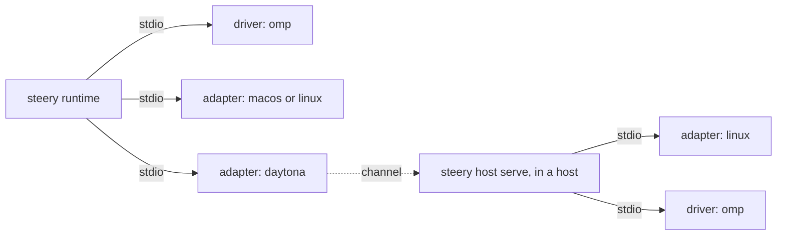

# The program protocol, version 3

The one contract between Steery's runtime (`steery`) and every **driver** and **adapter**,
and between the runtime's control and a remote host (§6). It is published under MIT in
[steery-dev/sdk](https://github.com/steery-dev/sdk) with `steery-sdk`, the Rust crate that
implements it, and the JSON Schema [`schema/protocol-v3.json`](schema/protocol-v3.json),
which holds every shape below. Steery's own drivers
([steery-dev/drivers](https://github.com/steery-dev/drivers)) and adapters
([steery-dev/adapters](https://github.com/steery-dev/adapters)) are programs like any
other: the runtime knows no program by its id, and every one is added the same way (§7).

## 1. Programs

| Program | Connects Steery to | Wire `kind` |
|---|---|---|
| **driver** | one harness: an agent product | `harness` |
| **adapter** | one kind of machine: an operating system, or hosts it makes | `machine` |

An adapter **provides** one of two things:

- `processes`: an operating system. It starts, finds, inspects and signals processes on
  the computer it runs on, and keeps the runtime running as a service there. Its id is the
  system's name as Rust spells it (`std::env::consts::OS`: `macos`, `linux`), and it
  answers that same name as `machine.os`: the runtime runs the one named for the system it
  runs on, and reads it as missing where `machine.os` names another.
- `hosts`: hosts, one for each conversation, made by a vendor's service (Daytona's
  cloud, for one). It makes, starts, stops and deletes hosts, and gives a command whose
  standard input and output reach `steery host attach` inside one. Inside the host,
  `steery host serve` uses the operating-system adapter of that host (`linux`) for its
  processes. A machine whose adapter makes hosts runs each conversation in a host of its
  own, and none on the computer that runs it.



Three rules hold for every program:

1. **The runtime is its only client.** A program never talks to Steery's server, never
   holds the machine's key, and never sees a signed answer.
2. **A program states facts and does what it is asked; it decides nothing.** Whether
   words go in, which conversation is resumed, whether a process is stopped: the runtime
   decides, and asks.
3. **A program changes nothing in a harness but what `setup/plan` lists**, and the runtime
   writes those entries itself and records them. The one other write is a hook's
   `append` (§4.1), which the harness itself asks its hooks for.

## 2. Transport

- The runtime starts the program as a child process and speaks JSON-RPC 2.0 to it, UTF-8,
  one JSON object per line on standard input and output. A line holds no newline of its
  own and is at most 16 MiB; a longer one is skipped whole. Standard error is the
  program's log, kept by the runtime.
- The runtime sends requests and notifications. A program answers requests and sends
  notifications. A program sends no requests.
- **Ids are strings the runtime chooses.** The same id sent again, with the same method
  and parameters, is answered from its first result and never acted on twice. A program
  keeps the answers to at least its last 256 ids.
- **Strict shapes.** Every params and result object, and every object inside one, has
  exactly the fields this document gives it. A field it does not define is an error:
  a program answers such params with code `-32602`, and the runtime reads such a result
  as `refused`. Values the harness or a person wrote (a tool's `input`, a hook's
  `document`, an entry's `value`) are any JSON and are passed as they came. An optional
  field (marked `?`) is absent, never `null`; `null` is a value only
  where a row names it.
- **Times** are milliseconds since 1970, UTC, as integers. **Paths** are absolute.
  **Bytes** are base64 (standard alphabet, padded).
- **A refusal** is a JSON-RPC error with code `-32001` and
  `data: {"refused": <word>, "line"?: <one line for a person>}`. The word is one of §8. Any
  other error is read as `refused`.
- **Unknown method:** code `-32601`. The runtime reads it as `selection-unsupported`.
- **A bad request:** code `-32600`, answered to a line that is not JSON or is over
  16 MiB, to a request sent before `initialize` is answered, and to an id sent again with
  another method or other parameters.
- **Timeouts** are the runtime's, per method (§9). A late answer is dropped.
- **Shutdown:** the runtime sends `shutdown`, waits for its answer, closes standard input,
  and sends SIGTERM to a program still running 5 s later.

## 3. `initialize`

The runtime's first request. Nothing else is sent before its answer.

```json
{"jsonrpc": "2.0", "id": "1", "method": "initialize",
 "params": {"protocol": [3], "runtime": {"release": "7.0.0", "os": "linux", "arch": "x86_64"},
            "home": "/home/ada", "config": "/home/ada/.config/steery",
            "settings": {"DAYTONA_API_KEY": "…"}}}
```

`protocol` lists the versions the runtime speaks; `settings` holds the values the person
gave for the settings the program declared (§3.4), and nothing else.

The answer is `{protocol, program, harness | machine, settings}`. It names one version;
the runtime closes a program that names one it did not offer. `program` is
`{id, kind, release, label, short, tint?, mark?}`:

- `id` is lowercase kebab-case, at most 64 characters: what `Session.harness` names for a
  driver, and the machine's adapter for an adapter. One computer has one program per id.
- `kind` is `harness` for a driver, which then answers `harness` (§3.1), or `machine` for
  an adapter, which then answers `machine` (§3.2). Never both.
- `label` (one line, at most 40 characters: `Claude Code`) and `short` (1 to 3 characters
  for a tile: `CC`) are what a person reads.
- `tint?` is the program's colour on a tile, `#rrggbb` in lowercase; absent, Steery's
  neutral tint.
- `mark?` is the program's mark: the `d` of one SVG path in a 24 by 24 box, filled with
  the even-odd rule, at most 4096 bytes of path commands and numbers. Absent, a tile shows
  `short`.

Every surface Steery draws a harness or a machine on — its apps, its web pages, its cards
— reads these from the program and from nothing else.

### 3.1 A driver

```json
{"protocol": 3,
 "program": {"id": "omp", "kind": "harness", "release": "1.0.0", "label": "omp", "short": "omp",
             "tint": "#6e62a8", "mark": "M4 4h16v16H4z"},
 "harness": {
   "levels": ["observe", "drive", "live"],
   "minimum": {"release": "18.4.12", "update": "omp update"},
   "sign_in": "run /login",
   "knowing": "…how an agent in this harness learns its conversation's id…",
   "transcript": "…one line on how its transcript file reads…",
   "identity": {"executables": ["omp"], "package": "@oh-my-pi"},
   "setup": {"reads_skills": true, "cuts_tool_text": false},
   "reader": {"sealed": {"tools": true, "mcp": false, "instructions": true,
                         "extensions": true, "history": true},
              "known": [], "unnamed": false},
   "facts": {"by_file": false, "resumes_in_place": true, "forks_beside": true,
             "keeps": {"model": false, "thinking": false}, "door": "plugin",
             "checks_idle": true, "worktrees": false, "acts": ["continue", "fork", "new"]},
   "hooks": [{"event": "UserPromptSubmit", "kind": "prompt", "via": "door",
              "says": ["context", "notice"]},
             {"event": "PreToolUse", "kind": "before_call", "via": "door", "says": ["calls"]}]},
 "settings": []}
```

| Field | What it says |
|---|---|
| `levels` | `observe` (§4.1), `drive` (§4.2), `live` (§4.3). Each needs the one before it. `live` is named exactly when `facts.door` is. |
| `minimum?` | `{release, update?}`: the oldest harness release the driver speaks to, and the command that updates it. The runtime compares it with `setup/plan`'s `found.release` and says the line itself. |
| `sign_in?` | The action that signs a person in, as a person reads it: `run /login`. |
| `knowing` | How an agent in this harness learns its conversation's id; Steery's skill carries it. |
| `transcript?` | One line on how the harness's transcript file reads, for a reader handed one. Absent: the harness keeps no transcript file, and a carry refuses. |
| `identity` | How the runtime recognizes the harness's processes (§3.3): `{executables, package?, session_variable?}`. |
| `setup` | `{reads_skills, cuts_tool_text, call_bound?}`. `reads_skills`: the harness reads Steery's skill from the entry `setup/plan` lists; where false, the runtime carries the whole skill in its MCP handshake. `cuts_tool_text`: the harness cuts an MCP tool's description before its model reads it, so the runtime also says its escalation policies whole at `session_start`. `call_bound`: the longest the harness waits for one MCP call, in seconds, where no entry can lengthen it; the runtime answers a wait within it. |
| `reader?` | The one-shot reader (§4.2): `{sealed, known, unnamed}`. `sealed` says which of `tools`, `mcp`, `instructions`, `extensions`, `history` the reader shuts out (true) or still reaches (false); the runtime tells a person and tries the most sealed reader first. `known`: models the reader runs that `models` may not list. `unnamed`: the reader runs the harness's own model when given none. Absent: the driver has no reader. |
| `facts` | What the holder rule and offers read, below. |
| `hooks` | Every moment of the harness the runtime reads (§4.1): `[Hook]`. |

`facts` is:

- `by_file`: a conversation is continued by its transcript path, not its id.
- `resumes_in_place`: a continue runs only in the folder the conversation ran in, and is
  refused `no-place` where that folder is gone.
- `forks_beside`: a fork may run beside a live writer.
- `keeps: {model, thinking}`: what a continue keeps without being told; for one it does
  not keep, the runtime passes the conversation's last known value.
- `door?`: how a live conversation is reached (§4.3). `plugin`: Steery's plugin door
  (§4.4), which applies a model itself; `picks`: the harness's own door, which applies a
  model itself; `keeps`: the harness's own door, which keeps its own. Absent: no live
  door.
- `checks_idle`: the door checks itself that the conversation is idle as it takes words,
  so words that must go in only while nothing runs (`immediate`) may go through it.
- `worktrees`: `start` makes a fork or a new conversation in a new worktree when asked.
- `acts`: which of `continue`, `fork`, `new`, `hand` the driver does at all.

A **Hook** is `{event, kind, via, says, waits?, env?}`:

- `event`: the harness's own name for the moment, unique in the list.
- `kind`: what the moment is. `session_start`, `prompt` (a person's instruction went in),
  `before_call`, `after_call`, `turn_end`, `session_end`, `permission` (the harness asks
  its person to allow a call), `notification` (the harness tells its person something),
  `sub_agent_start`, `changed` (what the conversation runs on changed: its model). The
  kind says what the agent is doing from then on: `prompt` and `after_call` working,
  `before_call` waiting on the call, `turn_end`, `session_end`, `permission` and
  `notification` nothing, `session_start` and `sub_agent_start` no claim. A `changed`
  moment says nothing of where the conversation stands but its Moment's state fields.
- `via`: `command`: the harness runs `<hook> <event>` (`setup/plan`'s `hook`) with its
  document on standard input; `door`: the plugin sends the harness's document over the
  door (§4.4). Either way the runtime reads the document with `hook/read`.
- `says`: the paragraphs a moment of this event can give the agent, which the runtime
  gives nowhere else. `context`: Steery's paragraph for the conversation (at a
  `turn_end`, it keeps the agent going with it; at a `sub_agent_start`, it reaches the
  sub-agent). `notice`: that words wait for the agent. `calls`: a line about the shell
  command the call runs. `working`: a paragraph for a sub-agent in the middle of its
  work. An empty list: the moment is only read.
- `waits?`: the seconds the harness gives this hook before it goes on without it, as
  `setup/plan` wrote it. The runtime answers within `waits - 90`. Absent: the runtime
  answers at once. One entry per event carries the longest wait the event needs (a call
  that asks the person, `Call.asks`); a moment that waits on nobody is answered within 5 s
  whatever `waits` says, so a long `waits` never holds an ordinary call.
- `env?`: names of variables of the hook's process the driver reads (`CLAUDE_ENV_FILE`);
  the runtime passes their values in `hook/read` and `hook/answer`.

### 3.2 An adapter

```json
{"protocol": 3,
 "program": {"id": "daytona", "kind": "machine", "release": "0.1.0", "label": "Daytona",
             "short": "Dt", "tint": "#1f2937"},
 "machine": {"provides": "hosts", "keeps": "filesystem", "idle": "activity",
             "optional": ["archive", "keepalive", "expose"], "builds": true, "channel": "argv",
             "os": "linux"},
 "settings": [{"name": "DAYTONA_API_KEY", "secret": true, "required": true,
               "about": "An API key from app.daytona.io/dashboard/keys"}]}
```

`machine.provides` is `processes` or `hosts`, and the rest of `machine` is that
kind's facts:

- `processes`: `{os: "macos" | "linux", service: "launchd" | "systemd"}`.
- `hosts`: `keeps` is what survives `hosts/stop` (`filesystem`, `memory`, or
  `volume`: only the folder in `persist?`); `idle` is the vendor's own timer
  (`activity`, `ttl`, `none`); `optional` lists the optional methods it has, by their last
  word (`archive`, `pause`, `fork`, `keepalive`, `expose`); `builds?` is true where
  `hosts/ensure` takes a `source` of `{dockerfile}` (§5.2), absent where it does not;
  `channel` is `argv` (§5.2) or `stream` (§5.3); `os` is the operating system inside its
  hosts (`linux`); `unavailable?` is
  one line saying why no host of this adapter can be had from this computer, whatever
  the settings, naming what to install or change (`Daytona's channel runs ssh on this
  computer, and none is installed: …`). The runtime adds no machine of an unavailable
  adapter, offers none, and reads a machine it runs as Missing with the line. The adapter
  still refuses the methods that need what is missing, as the guard where it is used.

### 3.3 Names every program reads

The runtime and every program read these the same way.

- **A process runs as a harness** when the file name of its first argument is one of
  `identity.executables`, or when that file name is `node`, `bun`, or begins with
  `python`, and a later argument that does not begin with `-` has a file name that is one
  of `executables` or path components that include `identity.package`'s components in
  order, adjacent (a package `@openai/codex` matches
  `…/node_modules/@openai/codex/bin/codex.js`). Arguments are split on spaces, tabs and
  NULs.
- **`STEERY_STARTED=<pid>:<what>`** marks a harness process started for Steery. `<what>`
  is `nothing` (it writes no conversation: a version, a model list, a reader),
  `turn:<harness>:<external_id>` (a turn that continues that conversation) or
  `turn@<folder>` (a fork's or a new conversation's turn, by the name of its turn
  folder). The runtime sets it on every process it starts for a harness, by naming
  `<what>` in its operating-system adapter's `process/start` (`started`), which writes
  its own pid; a driver sets `<its own pid>:nothing` on every harness process it starts
  itself; nothing else sets it. It is believed only where the process's parent is
  `<pid>` and is not pid 1. A plugin stays out of a process it marks `nothing`; a stop
  finds every process whose value names the turn it stops, whatever its parent.
- **`STEERY_LEAD=<harness>:<external_id>`** is put by a conversation's plugin or hooks on
  the processes its agent starts. A harness process that inherits a lead naming another
  conversation is that conversation's sub-agent. Where a harness puts its own id in its
  own process (`identity.session_variable`, `CODEX_SESSION_ID`), that variable inherited
  is read as the same lead. A moment's lead is the runtime's to read, never a driver's:
  for a command hook, from the hook process's own environment (`STEERY_LEAD`, else
  another driver's `identity.session_variable` that it inherited); for a door, from
  `hello.lead`.
- **MCP request headers** name the conversation an MCP call is made in:
  `Steery-Harness` (a driver id), `Steery-External-Id`, and, where a sub-agent makes the
  call, `Steery-Sub-Agent` (the sub-agent's id; the other two then name its lead). Values
  are trimmed; both of the first two or neither.
- **The delivery marker** `steery-delivery:<name>` is in every set of words Steery puts
  into a conversation. It matches only whole: the character after `<name>` is not a
  letter, a digit, `.`, `-` or `_`.
- **Which conversation a process or an MCP call is in**, first match wins: the headers;
  then for the process and each of its parents up to 8, stopping at pid 1: the
  `session_variable` in the environment of a process that runs as its harness; an
  absolute path on its command line that is a listed conversation's transcript; the one
  conversation whose transcripts it holds open (two or more name none).

### 3.4 Settings

A program declares the settings it needs: `{name, secret, required, about}`. The person
gives them once, by `--setting NAME[=VALUE]` where the program is put to use: an adapter
that makes hosts at `steery setup --adapter <id>` on a computer (or on Steery's web, where
a cloud machine is added), a driver's at `steery programs add` (§7). A `secret` one not
given there is typed at that terminal, unechoed, and never leaves the computer; any other
not given is asked there too, or on the card the new machine raises. An adapter's values
are checked with `hosts/list` against the vendor and kept in the computer's Steery folder
for the person's user alone (0600); a driver's are kept in its record (§7),
0600 too, and a driver added again keeps each value given before that is not given
again. They are passed only in `initialize`. A program never asks for anything else, and
nothing it declares is read from the environment the runtime runs in.

## 4. Driver methods

A driver answers the methods of its levels. A method its facts rule out is unknown
(`-32601`): `hook/read` where the driver declares no hook, and `hook/answer` where no
hook is `via: command`; `stop`, `say`, `pick` and `recap` where the door is `plugin`,
which the runtime speaks itself; `reader` and `reader/read` where `harness.reader` is
absent.

### 4.1 Observe

| Method | Params | Result |
|---|---|---|
| `setup/plan` | `{mcp_url, skill, hook, door, release, timeout}` | `{found?: Found, refused?, entries: [Entry], notes: [string], install?: {argv, about}}` |
| `sessions/list` | `{seen_since?, transcripts: [path]}` | `{sessions: [Session], excluded: [string], complete}` |
| `sessions/locate` | `{external_id}` | `{session: Session}`; refused `not-found` |
| `sessions/read` | `{external_id, sub_agent?, cursor?, tail?}` | `{cursor, events: [Event], more, reset, whole, after?}` |
| `sessions/fold` | `{external_id, sub_agent?, cursor?, records: [Record], quiet}` | `{cursor, events: [Event], consumed}`; refused `selection-unsupported` |
| `hook/read` | `{event, document, env}` | `{moment?: Moment}` |
| `hook/answer` | `{event, document, env, answer: Answer}` | `{stdout, exit_code, append?: {path, text}}` |

**`hook/read`** reads one hook's document, a string: the standard input of a command
hook, or the `document` of a door's `moment` frame (§4.4) as its JSON text, read exactly
the same way. A plugin classifies nothing: what a call is, its group, whether it asks the
person, are the driver's alone, so the plugin sends the harness's payload as it got it.
`env` is `{}` for a door moment.

**`setup/plan`** is given Steery's MCP URL; the skill's Markdown; `hook`, the command line
a hook runs, to which the hook's `event` is added as one more argument; `door`, the
runtime's loopback door URL (§4.4); the runtime's release; `timeout`, the seconds an MCP
entry gives one call. It answers what it found (`{binary,
release, root}`, absent where the harness is not installed), `refused?` (one line:
why Steery does not set this harness up here), `install?`, and the entries.

`found.binary` is absolute, and the harness the runtime later starts is that one. A driver
looks for its harness's executable on `PATH`, then in the folder its vendor's installer
writes it to (each driver's README names it), so a harness its installer just put in a
folder not yet on `PATH` is found.

`install` is given only where `found` is absent and the driver can install its harness on
this system: `argv`, the vendor's own installer (a vendor's documented `curl … | sh` is
run as written, `["sh", "-c", "curl … | sh"]`), and `about`, one line for a person that
holds the exact command line `argv` runs and where it installs the harness. The runtime
names no harness here: it shows `about` and `argv` both, runs `argv` only once a person
agreed — chose it at a terminal and said yes, or passed `steery setup --install`; nothing
is installed unattended without it — with the person's environment and no standard input,
through the operating-system adapter (`process/start`), within 10 minutes, its output
kept in the host's Steery folder's `logs/`, and then asks `setup/plan` again. An installer
that exits 0 and leaves `found` absent has failed.

An **Entry** is `{path, format: "json" | "toml" | "text", at?, value, carries}`: an
absolute file, and the place in it (a JSON Pointer or a TOML key path; absent: the whole
file, and a `text` value is a string). `carries` lists what reaches the harness through
it: `mcp`, `skill`, `hooks`, `plugin` (one entry may carry several: pi's plugin carries
its MCP entry). A JSON `at` may end in `/-`, JSON Pointer's past-the-end index: the value
is then one element of the array there, added once beside the elements the file holds (an
equal element already there counts as it), and given back by removing that element alone;
the array and its parents are made where missing, and an array left empty is removed. A
harness that keeps hooks in arrays its person shares (Claude Code's `settings.json`,
Codex's `hooks.json`) is given its hooks this way. The runtime merges each entry
byte-exactly, records it, and gives it back when the harness is removed. An entry an
earlier plan listed and this plan does not is given back too, so a driver that renames a
file (a versioned plugin copy) lists only the new one. Nothing is written until every
plan of a setup run has answered.

**`sessions/list`** answers the conversations updated since `seen_since` (all where
absent), reading also the transcripts the harness's own moments named (`transcripts`),
which may lie outside its own folders. A **Session** is:

| Field | What it says |
|---|---|
| `external_id` | The harness's id for it. |
| `cwd?`, `title?` | The folder it runs in; its title. |
| `created_at?`, `updated_at` | When it began (for a conversation continued over several files, when the first began); when it last changed. |
| `transcripts` | Every file of the conversation on this host, oldest first: at least one where `harness.transcript` is given, and none where it is absent (a harness that keeps its conversations somewhere else, read through `sessions/read`). A path is always a local file the runtime may read and match against processes. |
| `parent?` | The conversation it was forked from, where it names one. A file that only continues the same conversation is no fork. |
| `app` | It was started in the harness's app, not a terminal or a program. |
| `sub_agents` | `[SubAgent]`: the sub-agents working in it. |

A **SubAgent** is `{external_id, lead?, name?, task?, started_at?, started_by?,
transcripts}`: `lead` is the sub-agent that started it (absent: the conversation's own
agent did), `name` its name or role, `task` the first line of what it was asked,
`started_by` the id of the call that started it.

A sub-agent is never listed as a session, nor is a run with no person at it (a headless
run, a program driving the agent). `excluded` names the ids whose every transcript is one
of those, so a missing one is not read as gone. `complete` is false where some file named
its conversation ambiguously; a conversation absent from a complete listing is gone.

**`sessions/locate`** answers one conversation by its id, however old.

**`sessions/read`** answers the events of a conversation, or of one of its sub-agents,
after `cursor`:

- `cursor` is opaque, survives a restart of either side, and points between whole
  records: a record not yet ended by its newline is left for the next read.
- `tail` (bytes) reads only the newest records within that many bytes of the end, for a
  look at where a conversation stands; its `cursor` continues from the end.
- `more`: events remain past this answer; the runtime reads again from `cursor`.
- `reset`: the conversation's history is no longer what the old cursor followed (its file
  was rewritten or replaced, or a conversation kept as a tree went back to an earlier
  entry and took another branch); these events start again from the beginning of the
  history it has now, and what was built from the old cursor is dropped. Tokens are spent
  on a branch left behind too: a driver gives them as `tokens` events with `count:
  response` on the history it has now, so they are counted once.
- `whole`: the events start at the conversation's beginning.
- `after`: the id of the newest record such that every record written before it was read
  (on a tree, every record of the history it has now up to it, and every other one
  written before it): the plugin door's `welcome.entries.after` (§4.4) where the runtime
  goes back to the door. Absent after a `tail` read, and where no record with an id was
  read.
- `cursor` may be one `sessions/fold` answered: the read goes on after the last record
  that fold consumed, where the transcript holds it on the history it has now; where it
  holds it off that history, `reset`; where it holds it not yet, no events.

**`sessions/fold`** answers the events of records a driver whose `facts.door` is `plugin`
was given from its plugin's `entries` frames (§4.4), folded exactly as `sessions/read`
folds the same records from the transcript, so either feeds one conversation's events
with the same ids. A driver whose door is not `plugin` refuses `selection-unsupported`.

- A **Record** is `{id, value?}`: the harness's id for one of its records, and the record
  as the harness keeps it. `value` is absent for a record over 8 MiB: the driver reads
  that one record from the transcript by `id`.
- `records` follow `cursor` (absent: they start at the conversation's first record), in
  the order the harness appended them, every branch of a tree included: each response is
  folded once, and a move to another branch needs no `reset`.
- `quiet`: milliseconds since the newest record arrived. A driver that holds back a
  record until more follow (a failed request the harness may retry) holds it while
  `quiet` is short, as `sessions/read` holds it while the transcript is new.
- `consumed`: how many of the leading records the events say. The others are given
  again, with the records after them, to the next fold from `cursor`.
- `cursor` is opaque, survives a restart of either side, and is also a `sessions/read`
  cursor.

An **Event** is one of:

| `type` | Fields |
|---|---|
| `turn_began` | `at, turn?` |
| `turn_ended` | `at, turn?, state: finished \| failed \| interrupted, failure?: Failure` |
| `words` | `at, id, voice: person \| agent \| thought \| tool \| summary, text, call?, clips: [Clip]` |
| `rollback` | `at, turns`: the harness took back the newest `turns` person instructions |
| `call_began` | `at, call: Call` |
| `call_ended` | `at, id, ok, chars, tail?` |
| `tokens` | `at, count: response \| total, response?, model?, input, cached, cache_write?, output, reasoning, context_left?` |
| `model` | `at, model, provider?, thinking?` |
| `sub_agent` | `at, external_id, call?, state?: running \| finished \| failed \| interrupted, error?` |
| `fork` | `at, parent`: every event before it is the parent's history, copied into this conversation |
| `compacted` | `at, id, by: Compactor, tokens_before?, tokens_after?`: the harness compacted the context |

- `turn` is the harness's id for the turn. A turn ends `interrupted` where the harness
  wrote no end and its process is gone, or where it was stopped (pi records `aborted`).
- `words`: `id` is stable for that message; `person` is only what a person typed (never
  an envelope, injected context or a harness's own message), `agent` the agent's answer,
  `thought` its reasoning or progress where the harness writes it as text, `tool` the
  text of a call's result, given after that call's `call_ended` (`call` names it; a
  call's input is `call_began.call.input` and is never repeated as words), `summary` a
  harness's summary of earlier history. A `model` event without `thinking` says nothing
  about thinking (omp records none).
- A **Clip** is something a person's words carried, tagged by `kind`: `bytes {data,
  media_type?, name?}`, `file {path, media_type?, name?}` (bytes kept in a file here),
  `path {path, name?}` (a file the person named), `link {url}`.
- A **Call** is `{id, tool, input, group, server?, steery?, asks?, parent?, response?}`:
  `tool` as the harness spells it, with an MCP tool as `mcp__<server>__<tool>`; `input`
  as the harness wrote it (`null` where it gave none); `group` one of `shell`,
  `files-read`, `files-edit`, `search`, `web`, `browser`, `code`, `agents`, `plan`, `ask`,
  `steery`, `memory`, `harness`, `media`, `custom`, `mcp` (with `server` the MCP server as
  the harness names it); `steery` the name of Steery's own tool where the call is one
  (`requests_create`); `asks` where the call waits on the person inside the harness
  (`{"questions": [Question]}` or `{"plan": text}`); `parent` the call it runs inside;
  `response` the model response that made it. A call a harness makes through another of
  its tools (omp's `write` to an `xd://<tool>` device) is reported as the call it makes:
  `tool` the device's tool, `input` its arguments as the device reads them.
- A **Question** is `{question, header?, multiple, options: [{label, description?,
  preview?}]}`.
- `call_ended`: `chars` is the length of the result's text, `tail` its last 8 lines.
- `tokens`: `input` counts every token read, cache reads and writes included; `cached`
  and `cache_write?` are of `input` (absent: the harness does not say); `reasoning` is of
  `output`. `count: response` is one response's own count (named by `response`; one
  response said twice is counted once, at its largest); `count: total` is the running
  total of the whole conversation (Codex). `context_left` is the share of the context
  window left after it, 0 to 1.
- `sub_agent` is what the conversation said about one of its sub-agents: started by
  `call`, or ended.
- `compacted`: the harness replaced the context before it with a summary. `id` is the
  harness's for its record of it. A **Compactor** is tagged by `kind`: `harness {reason?}`
  (on its own; `reason` is `threshold` where the context reached the harness's limit,
  `overflow` where the model refused a call as over its limit, `idle` where it compacts a
  conversation left idle, else the harness's own word, absent where it records none),
  `person` (its person asked, `/compact`), `steery {compaction}` (the door's `compact`
  ask, §4.4, by its `id`). `tokens_before` and `tokens_after` are the context's tokens just
  before and just after, summary included, as the harness counted them; absent where it
  records none. History a fork copied says none.
- A **Failure** is `{kind: sign_in | rate_limit | context_full | other, line, service,
  http_status?, code?, retry_at?, provider?, model?, thinking?}`. `sign_in`: the harness
  could not sign in to its model service (a 401, or the harness's own code for it);
  `rate_limit`: the service refused for a limit and takes requests again later (429, 503,
  529, or the harness's own code), with `retry_at` where it said when; `context_full`: the
  prompt is over the model's limit, and no turn of it runs again. `service`: the failure
  came from the model service, not the harness. `line` is the harness's own words, one
  line. A turn is failed only by its final outcome: a failure the harness got past is no
  event.

A **Moment** is what `hook/read` answers:

| Field | What it says |
|---|---|
| `event` | The `Hook.event` it is. |
| `external_id` | The conversation it is in; for a sub-agent's moment, the conversation the sub-agent works in. |
| `sub_agent?` | The sub-agent whose moment it is. |
| `at?` | When it happened. |
| `cwd?`, `transcript?` | The folder it runs in; its transcript file, where the harness keeps it outside its own folders. |
| `call?` | The `Call` it is at (`before_call`, `after_call`, `permission`). |
| `ok?` | At an `after_call`: whether the call succeeded. |
| `outcome?` | At a `turn_end`: `finished`, `failed`, `interrupted`. |
| `continued` | At a `turn_end`: a hook already kept this turn going once. |
| `person_exited` | At a `session_end`: the person left at the prompt, by the harness's own word that they are done. |
| `prompt?` | At a `prompt`: the instruction, where the harness gives it. |
| `context_left?` | 0 to 1. |
| `model?`, `thinking?` | The model it runs on now and how hard it thinks, in the harness's own words, where the moment says. |
| `failure?` | At a `turn_end` whose `outcome` is `failed`: the `Failure`, where the harness says why. |
| `suggestions?` | At a `permission`: the harness's own ways to allow such calls from now on, in its order, each `{label, about}`: what a person reads for it (`Always Bash(cargo check:*)`) and one line on how far it reaches (`this project, for you`). `always: {suggestion: n}` is the n-th. Absent: none. |

`hook/read` answers no `moment` for a document that is no moment Steery carries.

`context_left`, `model`, `thinking` and `failure` are state, never events: no transcript
record has the moment's id, so the runtime takes each as what the conversation stands at
now, over what its events last said and under what its door says (§4.3), and counts
nothing from them. A moment without one says nothing about it.

An **Answer** is what the runtime decided: `{say?, decision?, lead?}`. `say` is a
paragraph for the agent. `decision` is `{"allow": {reason, always?}}` or `{"deny":
{reason}}`: let the call go without the harness asking (`always`: `{"suggestion": n}`,
one of the moment's `suggestions`, `"tool"`, this tool for the rest of the session, or
`"everything"`), or block it, the reason being what the agent reads (a person's answer to
a question, why a plan was not approved). `lead` is the `STEERY_LEAD` value the
conversation's later processes should inherit. An empty Answer says nothing.
`hook/answer` turns it into what the harness reads: the hook's standard output (empty:
print nothing), its exit code, and `append`, a line the hook adds to a file the harness
named for it (Claude Code's `CLAUDE_ENV_FILE`).

### 4.2 Drive

| Method | Params | Result | Refusals |
|---|---|---|---|
| `held` | `{external_id}` | a Holder, or `{look: {transcripts, strays, beyond?}}` | none |
| `idle` | `{external_id}` | `{sample?: Sample}` | none |
| `models` | `{}` | `{models: [Model], unlisted?: {thinking}, watch: [path]}` | `no-binary`, `refused` |
| `start` | `{act, external_id?, cwd, folder, worktree, model?, thinking?, reads}` | `{argv, env, cwd, stdin: "words" \| "none" \| "held", inbox}` | `not-found`, `no-place`, `model-missing`, `selection-unsupported`, `no-binary`, `start-failed` |
| `turn/read` | `{turn, stream: "stdout" \| "stderr", line, delivery?}` | `{named?, took?, ended?: {state, error?}, refused?, events: [Event], title?}` | none |
| `stop` | `{external_id, holder}` | `{stopped, proof?}` | `not-stopped` |
| `receipt/mark` | `{external_id}` | `{mark}` | `selection-unsupported` |
| `receipt/find` | `{external_id, mark, delivery}` | `{found, owner?}` | `refused` |
| `reader` | `{system?, model?, thinking?, tools: "none" \| "read", cwd, asked}` | `{argv, env, cwd, stdin: "words" \| "none", files: [{path, content}], read: "whole" \| "events"}` | `no-binary`, `model-missing`, `selection-unsupported` |
| `reader/read` | `{output}` | `{text}` | `no-answer` |
| `terminal` | `{external_id, cwd, holder?}` | `{command, app?, line?}` | `not-found` |

**`held`.** A **Holder** is `{"nobody": {proof}}` or `{"person": {door?: "picks" |
"keeps", stop}}`, and `stop` is one of:

- `{"owner": token}`: only the harness's owner of the conversation stops it, through the
  harness (a Codex window or app server, a Claude Code background job). `token` is
  opaque, at most 1024 characters; the runtime keeps it and gives it back in `stop` and
  `receipt/find`. `{"owner": null}`: the owner runs no turn now.
- `{"process": {pid, process_start, certain, how}}`: that process holds it; `certain` is
  false where the driver could not prove it is the holder; `how` is a few words a person
  reads after "holds it" (`in a terminal`).
- `{"beyond": line}`: somewhere the runtime cannot reach, said in one line.

`nobody` needs proof the driver can name: the harness's own registry, or no process
writing the transcript. A driver that cannot prove absence answers `process` with
`certain: false`. A driver that knows only where to look answers `look`: the
conversation's transcripts, and `strays`, true where a process running as the harness
that no door, turn or `STEERY_STARTED` answers for may hold the conversation without
holding its transcript open. The runtime then asks the operating-system adapter which
processes hold those files or name them on their command lines, adds the plugin door's
own knowledge (§4.4), and reads a stray as `certain: false`. `beyond` is `[{arg?, line}]`
(absent: none): a process that holds or names the transcripts and has an argument
exactly equal to `arg`, or any such process where `arg` is absent, is read as
`{"beyond": line}`, and the runtime never signals it (Codex's `app-server`, which serves
every other thread too; a Claude Code its own registry does not name).

**`idle`** answers what the driver can prove of a conversation now, where no door says
it. A **Sample** is `{state: running | finished | failed | interrupted, observed_at,
started_at?, ended_at?, model?, thinking?, error?, vacant, if_unheld}`: `vacant` says
nobody is in the conversation at all (an idle window is not vacant: its person may be
reading); `if_unheld` says the sample stands only if no process holds its transcripts,
names one on its command line, or, where `held` says `strays`, runs as a stray, which the
runtime checks before it uses the sample. No `sample`: the driver cannot say, and unknown is
never idle.

**`models`.** A **Model** is `{provider?, model, label?, thinking: [string], cost?}`, the
harness's default first: `model` as the harness spells it, `thinking` its levels in the
harness's own words, `cost` US dollars per million input tokens where the harness says it.
`unlisted` says the harness also runs models it does not list; one seen in a conversation
is offered with `unlisted.thinking`. `watch` names the files whose change changes the
list (configuration, sign-ins, a model cache); the runtime asks again when one changes,
and at least every 10 minutes. A harness not on this machine is refused `no-binary`; a
list it cannot read (its person must sign in first) is refused `refused` with the
harness's line. The runtime keeps the last list.

**`start`** starts nothing; it answers a launch plan. The runtime has made the turn's
`folder`, writes the words to it, adds `STEERY_STARTED` (and `STEERY_COMPACT` where it
compacts the conversation first, §4.4), and starts the plan detached
through the operating-system adapter (§5.1), so a turn outlives a runtime restart and the
stop ladder can prove it gone. `stdin: "words"` is the words' file. `reads` are folders
outside `cwd` the turn reads. `worktree` asks for a new worktree for a fork or a new
conversation, where `facts.worktrees`. `start` checks first what it can check without a
process (omp: that the model is an exact entry of omp's own list) and refuses before
anything runs.

With `stdin: "held"` the runtime starts the process with a standard input that never ends
(`process/start` `held`) and discards its standard output. It hands the words through the
plugin door (§4.4) once a copy says `hello` from that pid, and keeps the process after the
turn.

A harness that must be spoken to during a turn (Codex's app server, Claude Code's
background jobs) gives a plan that runs the driver's own binary in a turn mode. Such a
plan answers `inbox: true` and binds a unix socket `inbox` in the turn's folder: the
runtime connects, writes more words for the running turn, closes its writing side, and
reads one line back, `heard` where the harness took them or the harness's words, which the
runtime reads as with `refused`. A connection refused means the turn is ending.

**`turn/read`** reads one line of a turn's output. `turn` names one run, and the runtime
gives every line of it in order from the first, under that name, also again after a
restart, so a driver may keep state across lines. `named` is the conversation the
harness named; `took` is true once a line shows the harness took the words that carry
`delivery`; `ended` is how the turn ends, where this line says so, unless a later line
says otherwise (a line written after the end says nothing); `refused` is the refusal word
a line of standard error means. The runtime reads a turn as taken once it is named and,
where the harness says it, `took`.

`events` are the events of the named conversation the line says (§4.1), stamped as the
harness stamped the line, before its transcript is read. Each is one `sessions/read`
gives the same fact under the same id — `turn` of `turn_began` and `turn_ended`, `id` of
`words`, `call.id` of `call_began` and `id` of `call_ended`, and a `count: total` of
`tokens` by its numbers — so the runtime folds it once, whichever comes first. A fact
whose id the transcript cannot give again is not an event here; the transcript's read
of it stands (Codex: a person's words, a compaction). A `model` event has no id; one
stamped before the model the runtime already folded does not replace it. `title` is the
conversation's title as the harness named it on this line; the newest stands over the
one `sessions/list` gives.

**`stop`** is the graceful step only: the harness's own way to end a turn, for an
`owner` or a `process` holder. The runtime sends the signals after it, through the
operating-system adapter, and only to a process it checked against the kernel: for a
`process` holder, wherever that process still runs, whatever `stopped` says. `stopped`
says this step ended the turn; a harness with no graceful stop of its own answers
`{stopped: false, proof}` with the line saying so. `proof` is the driver's one line of
evidence (the turn it ended and the state it reached), which the runtime records with
the stop.

**`receipt/mark`** and **`receipt/find`** prove that words went in where the door could
not say so (`say` answered `took: false`, or a plugin door answered `no-answer`: its timer
ran out while the harness still held the words queued). `mark` is an opaque point in the
conversation taken before the words are sent; `selection-unsupported` says there is none
here, and the door's word is the receipt. Behind a plugin door the door's word that it
took them stays the receipt, and the mark is only looked after when it gave none.
`receipt/find` looks after `mark` for the person input carrying the delivery marker
`delivery` (§3.3), and answers `found` and, where a turn of the harness's owner took it,
that `owner` token. Two inputs carrying it is `refused`. Both change nothing.

**`reader`** plans a one-shot read: `system` the instructions (absent: the harness's
own), `model` (absent: the harness's own, where `harness.reader.unnamed`), `thinking` (a
level `models` lists for that model; absent: the driver's own for a read; one the harness
refuses is `selection-unsupported`), `tools`, `cwd` (a private folder, or
the place being looked at), and `asked`, the text read. The runtime writes `files`
(paths relative to `cwd`) first, gives `asked` on standard input where `stdin` is
`words`, ends the read after 240 s, and reads at most 512 KiB of output: `whole` is the
answer, and `events` is given to `reader/read`, which answers the text in it.

**`terminal`** answers the command line that opens the conversation in a terminal,
quoted for a POSIX shell, where nothing but the person holds it (`holder` as `held`
said), `app` the URL that opens it in the harness's app, and `line` what a person reads
about it.

### 4.3 Live

A driver reaches a live conversation in one of two ways, and says which in
`facts.door`:

- **`plugin`: Steery's plugin door.** The harness loads a plugin, written by `setup/plan`
  like any other entry, that dials the runtime's loopback door and speaks the door
  protocol (§4.4). The runtime speaks it directly; the driver answers no live method. omp
  and pi work this way.
- **`picks` or `keeps`: the harness's own door.** The driver answers the methods below
  through whatever the harness offers (Claude Code's inbox socket, Codex's app server).

| Method | Params | Result | Refusals |
|---|---|---|---|
| `say` | `{external_id, words, mode: "steer" \| "queue" \| "immediate"}` | `{took}` | `no-door`, `no-answer`, `harness-busy`, `refused` |
| `pick` | `{external_id, model?, thinking?}` | `{model?, thinking?}` as read back | `model-missing`, `selection-unsupported` |
| `recap` | `{external_id, asked}` | `{text}`, written by the conversation's own model | `no-answer`, `model-missing` |

`steer` goes into the turn running, `queue` after it, `immediate` only where nothing runs
(else `harness-busy`, nothing handed over). `took` is true where the harness was seen
taking the words, false where they were handed over unconfirmed (the runtime then looks
with `receipt/find`).

A driver whose door is `picks` or `keeps` sends, unasked, `session/changed {external_id,
state}`, where `state` is a **LiveState**, the same shape the plugin door's `state` frame
carries:

| Field | What it says |
|---|---|
| `turn?` | `{began_at, says: [string]}`: a turn runs, begun then; `says` the ids of `say`s it took as Steery's. |
| `idle?` | The door checked the conversation idle. Absent: it cannot say. |
| `pending?` | Words wait to go in. |
| `typing?` | The person's editor holds text. Absent: it cannot say. |
| `compacting`, `retrying` | The harness is compacting its context; waiting to retry a request. |
| `jobs` | Background work running in the process that ends with it: jobs it runs and results waiting to be told. Absent: none. |
| `model?`, `thinking?`, `context_left?` | What it runs on now; the share of its context window left. |
| `calls` | `[{id, tool, since, children: [{id, tool}]}]`: the top-level calls running, oldest first, with calls running inside each; each `tool` named as a Call names it (§4.1), Steery's own as `mcp__steery__<tool>`. |
| `ended` | `[{id, at}]`: top-level calls that ended lately, oldest first, at most 64. Their times are the calls' true ends, over a transcript's. |
| `dialog?` | `{kind: select \| confirm \| input \| editor \| custom, title, since}`: the harness's own dialog open in front of the person. |
| `settled` | `[{began_at, at, says, failed, error?}]`: turns Steery's words began that ended, at most 16. |

A conversation is idle where `idle` is true, no turn runs, nothing is pending, `typing`
is false, and it is neither compacting nor retrying.

### 4.4 The plugin door, version 1

A plugin door is a WebSocket the harness's plugin dials on the runtime's loopback
listener, at the `door` URL `setup/plan` gave (`ws://127.0.0.1:<port>/door`). It carries no
credential: the listener is loopback only. One connection is one conversation in one
process. The door has its own version, independent of the runtime's release.

**Frames** are WebSocket text messages, each one JSON object with its type in `t`, at most
16 MiB. A frame that is unreadable, or whose `t` is unknown, is dropped; the connection
stays. Every time is milliseconds since 1970.

**Hello.** The plugin's first frame, within 5 s:

`{t: "hello", door: 1, harness, pid, session_id, mode, lead?, state?}`

- `door`: the door version the plugin speaks.
- `harness`: the id of a driver whose `facts.door` is `plugin`.
- `pid`: the harness process. `session_id`: the conversation this copy is in, a
  sub-agent's own id where it is one.
- `mode`: `tui` or `rpc` (a person, or a program drawing for one, is at it), `json` or
  `print` (a one-shot run, whose process ends with it). A process the runtime started
  held (§4.2) says `rpc`.
- `lead?`: `{harness, external_id}` where the copy is a sub-agent's: the conversation
  it works in. A copy whose lead it cannot name opens no door.
- `state?`: a LiveState (§4.3), as `state` frames send it.

The runtime answers `{t: "welcome", door: 1, entries?: {after?}}`, or closes with a code.
A plugin that is welcomed to another door version sends nothing more and waits for the
runtime to close. `entries` is present where the runtime takes the harness's records:
`after` the id of the last record it holds, absent to start at the conversation's first.

| Code | Why | The plugin |
|---|---|---|
| 4400 | The first frame was not a readable hello, or `harness` names no plugin driver | does not redial until its harness restarts it |
| 4409 | The runtime does not speak `door` | redials after 5 s, by when a newer plugin may be loaded |
| 4410 | A newer connection from the same `pid` and `session_id` replaced this one | does not redial |
| 1000 | The plugin closes: its conversation ended or moved | |

Any other drop: the plugin redials after 250 ms, doubling to 2 s, and from 250 ms again
once welcomed. For 3 s after the runtime starts listening, a conversation with no door is
read as reconnecting, never as nobody's.

**Liveness.** The runtime sends a WebSocket ping every 15 s and drops a connection from
which it heard nothing for 30 s, or to which a send takes over 30 s. The plugin answers
pings and sends none. A drop answers every ask in hand `no-answer`.

**Who a copy is.** A copy with a `lead` is a sub-agent's: it takes no words, no pick and
no stop, and its moments are filed under its lead's conversation. A copy without one
takes words and picks where its mode is `tui` or `rpc` or a turn runs.

**Plugin to runtime.**

| Frame | Fields | The runtime answers |
|---|---|---|
| `state` | `state`: a whole LiveState, sent when it changes, at most every 100 ms, and again after welcome | nothing |
| `moment` | `id, event, document`: a moment of a hook `via: door`; `event` its `Hook.event`, `document` the harness's hook payload as the plugin got it, which the runtime reads with `hook/read` (§4.1) | `{t: "answer", id, ok: {say?}}`, in order, per conversation |
| `settle` | `id, asked, parked, waiting, continued`: a turn of its own ended; the turn asked its person something, was parked, waits on a Steery request, or was already kept going once | `{t: "answer", id, ok: {say?}}`: where `say`, the plugin keeps the agent going with it. The plugin waits 1 s for it, then lets the turn end. |
| `answer` | `id, ok`, the op's answer below, or `id, refused, error?`: to an ask | |
| `entries` | `after?, records: [Record]`: the harness's records (§4.1), in the order it appended them; `after` the id of the record before the first one here, absent where they start at the conversation's first | nothing |
| `lost` | `why`: the copy cannot continue from `welcome.entries.after`; this connection carries no entries | nothing |

A plugin keeps the moments it has not had answered, at most 256, and sends them again on
its next connection; the runtime reads a moment `id` once. It waits for a moment's answer
only as long as its harness lets it (a prompt 1.5 s, a call 0.5 s), then goes on without
it.

**Entries.** Only a copy welcomed with `entries` sends them, every record from after
`welcome.entries.after`, then each new one as the harness appends it; a sub-agent's copy
sends its own conversation's. The copy keeps no records of its own: it sends from the
harness's memory of the conversation, so it sends `lost` where that memory no longer
reaches back to `after`. A frame carries at most 8 MiB of records; a record over 8 MiB
goes as `{id}` alone, and the driver reads it from the transcript. Each frame's `after`
is the last record id the copy sent before it, so the runtime takes a frame only where
`after` is the last id it took (the first frame's, the welcome's), and drops this
connection's entries at the first that is not.

**Runtime to plugin.** `{t: "ask", id, op, …}`, answered by an `answer` frame with the
same `id`: `ok` is the answer below, `refused` one of the refusals and `error` the
harness's own line. The same `id` asked again is answered from the first answer and never
acted on twice, for at least the last 256; an answer refused other than `no-answer` is
forgotten.

| `op` | Fields | `ok` answer | Refusals |
|---|---|---|---|
| `say` | `words, mode: steer \| queue, idle, throw?` | `{}` once the harness took the words | `harness-busy` (`idle` and the conversation is not idle: nothing handed over), `model-missing`, `no-answer` (handed over, not seen taken within 8 s), `ending`, `refused` |
| `pick` | `model?, thinking?` | `{model?, thinking?}` read back | `selection-unsupported`, `model-missing`, `ending`, `no-answer`, `refused` |
| `stop` | `say?` | `{stopped, running: [string]}`: whether a turn was stopped; background jobs still running | `other-turn` (`say` given and the turn running is not one that `say` began), `selection-unsupported`, `no-answer` (a turn still runs after 2.5 s), `ending`, `refused` |
| `recap` | — | `{text}` | `model-missing`, `selection-unsupported`, `ending`, `refused` |
| `compact` | `before, summary, least` | `{from, forgot}` | `harness-busy` (a turn runs: nothing done), `ending`, `refused` |

- A say's `id` is the id `LiveState.turn.says` and `settled[].says` name. `throw`: one
  throw's words go in once, however often a say carrying it is asked.
- `stop` without `say` is the person's pause, and marks the conversation parked.
- `ending`: the copy is letting the conversation go and took nothing; it answers every ask
  so from then on. The runtime waits up to 15 s for its connection to close, then goes the
  next way.
- `compact`'s `before` is milliseconds since 1970: the cut is the last entry at or before
  it that is a message of the person or the assistant, never a tool result, after the
  latest compaction and after the context's start. The context starts at the latest
  compaction's first kept entry, else at the first entry.
- `summary` replaces everything before the cut; the plugin puts the summary of the latest
  compaction, which the cut drops, before it. Only its own compaction is answered by the
  plugin's hook with this summary and cut, so no model runs; every other compaction passes
  the hook untouched.
- Tokens before the cut are estimated from the conversation's own model: their characters
  at its tokens per character, the growth from each of its responses to the next in one
  context over the characters between them; characters / 4 where it counted none.
- `least` is tokens: no such cut, fewer estimated between the context's start and the cut,
  or the harness declining, and nothing is done: `{from: <the context's start>, forgot:
  0}`. Nothing is done either where the provider still caches the context and the cut
  forgets less than half of what the context would hold after it (its newest response's
  tokens, less what the cut forgets, plus the summary): its newest response came after
  the latest compaction, within an hour where a response of the context wrote one-hour
  cache entries, else five minutes.
- `from` is milliseconds since 1970, when the context starts after the ask: the cut
  entry's time where it compacted. `forgot` the tokens estimated before the cut.
- A sub-agent's copy answers `compact` `refused`. The runtime waits 30 s for a `compact`
  answer.
- **A compact before a one-shot run's own turn.** A turn the runtime starts may carry
  `STEERY_COMPACT=<file>`: a `compact` ask as the door carries it (`{t: "ask", id, op:
  "compact", before, summary, least}`), in the turn's folder. The copy takes the variable
  out of its own environment, so nothing it starts inherits it, answers the ask before its
  turn's prompt runs as it would through the door, and writes the answer frame (`{t:
  "answer", id, ok}`, or `refused` and `error`) to `compacted.json` in the same folder,
  0600. A copy that cannot read the file writes nothing.
- `refused` answers an op the copy does not know, an ask it cannot read, and words asked
  of a one-shot run before its own turn.

## 5. Adapter methods

### 5.1 `processes`: an operating system

| Method | Params | Result | Refusals |
|---|---|---|---|
| `process/start` | `{argv, env, cwd, stdin?, held?, stdout, stderr, scope?, started?, status?}` | `{pid, process_start}` | `start-failed` |
| `process/list` | `{pids?}` | `{processes: [{pid, ppid, pgid, process_start, command, args?, user, cwd?, stopped?}]}` | |
| `process/environ` | `{pid, process_start, names}` | `{values: {name: value}}` | `not-found` |
| `process/files` | `{pid, process_start, writing}` | `{paths}`: the files it holds open | `not-found` |
| `process/listening` | `{port}` | `{processes: [{pid, process_start, command}]}`: those listening on that TCP port | `refused` (the sockets cannot be read) |
| `process/signal` | `{pid, process_start, signal: "int" \| "term" \| "kill" \| "cont", group}` | `{sent}` | |
| `service/plan` | `{label, binary, args, env, port, cpu, log}` | `{files: [{path, content, mode}], commands: [{argv, may_fail}]}` | |
| `service/status` | `{label}` | `{installed, running, pid?, process_start?, granted}` | `refused` (the service manager cannot be read) |
| `service/start`, `service/restart`, `service/remove` | `{label}` | `{}` | `refused` |

- `process_start` is the process's start time as the kernel gives it; two readings within
  10 s are the same start (`SAME_START`). Every method that names a process acts only
  where the pid still has that start, and is refused `not-found` otherwise
  (`process/signal` answers `sent: false`).
- `process/start` starts `argv` detached, in a session and process group of its own, with
  its whole environment `env`, standard input from the file `stdin` (none where absent;
  where `held`, one that never ends: it neither gives bytes nor ends, and nothing outside
  the process holds it), and standard output and error appended to the files `stdout` and
  `stderr`, made 0600. `held` with `stdin` is refused `invalid`.
  `scope` names a service (`label`): the process runs in that service's share of the CPU,
  where the operating system has one (a systemd slice when the runtime runs under
  systemd), and as it would otherwise where it has none. `started` names `<what>` of
  `STEERY_STARTED` (§3.3): the adapter sets `STEERY_STARTED=<its own pid>:<started>` in
  the process's environment, over any value `env` gives it. `status` names a file: once
  the adapter reaps the process it writes how it ended there, 0600, as `{"code": n}` or
  `{"signal": n}`; nothing where the adapter ended first. Refused `start-failed`.
- `process/list` lists the processes that run (a zombie is not listed); a pid asked for
  that runs nothing is absent. `command` is the executable's name, `args` the arguments
  with its own name first, absent where they cannot be read (it may then be any program),
  `cwd` the folder it works in now, absent where it cannot be read, `pgid` its process
  group, and `stopped` true where it is stopped (Ctrl-Z, SIGSTOP; absent: it is not).
- `process/files` answers the files the process holds open; where `writing`, only those
  it holds open for writing. A process forked that has not exec'd since answers
  `{paths: []}`: its descriptors are copies of its parent's.
- `service/plan` is pure: what installs the runtime as the service `label`, running
  `binary` with `args` and `env`, handed its loopback listener on 127.0.0.1:`port`, at
  `cpu` percent (1 to 100) of what the computer grants its user, its own output appended
  to `log`. It is planned against what is on disk now (a unit already installed keeps its
  `PATH`). The runtime writes the files, runs the commands in order, each within 60 s,
  stopping at the first failure of one that may not fail, and then `service/restart`. A
  command that loads the service waits out the old one's stop where the manager refuses
  a load until it has gone (launchd's `bootstrap` fails with error 5 while the job it
  booted out still stops). A file that differs from what is on disk is the sign that the
  service needs installing again.
- `service/status`: `installed` (its unit is on disk), `running` (its manager runs it,
  with that pid), and `granted`: the percent of one core the computer grants the
  runtime's user.
- `service/restart` stops the service and starts it again; processes it started that
  outlive it (turns) keep running. `service/remove` stops and removes the service, and
  stops none of those processes. All three are refused `refused` with the manager's line.

### 5.2 `hosts`: an adapter that makes hosts

| Method | Params | Result | Optional | Refusals |
|---|---|---|---|---|
| `hosts/list` | `{labels?}` | `{hosts: [{host, state, labels, created_at}]}` | | `offline`, `refused` |
| `hosts/ensure` | `{key, source?: {snapshot} \| {image} \| {dockerfile}, labels}` | `{host}`, made, or found by `key` | | `offline`, `refused`, `start-failed`, `no-place` |
| `hosts/start` | `{host}` | `{state}` | | `offline`, `refused`, `not-found`, `start-failed` |
| `hosts/stop`, `hosts/delete` | `{host}` | `{state}` | | `offline`, `refused`, `not-found` |
| `hosts/archive`, `hosts/pause` | `{host}` | `{state}` | yes | `offline`, `refused`, `not-found` |
| `hosts/fork` | `{host}` | `{host}` | yes | `offline`, `refused`, `not-found`, `start-failed` |
| `hosts/keepalive` | `{host}` | `{}` | yes | `offline`, `refused`, `not-found` |
| `hosts/expose` | `{host, port}` | `{url, headers?}` | yes | `offline`, `refused`, `not-found` |
| `hosts/put` | `{host, path, content, mode}`: base64 content | `{}` | | `offline`, `not-found` (no such host), `refused` (the bytes did not arrive whole; a partial file is removed first) |
| `hosts/channel` | `{host, command: [string]}`: the command, its program first | `{argv, env}` or `{stream}` | | `offline`, `refused`, `not-found` |

`host` is the vendor's own id for the host. `state` is in the vendor's own word.

`offline`: the vendor cannot be reached or is down (a 502, 503 or 504, a request out of
time); `refused`: the vendor answered no (a bad key, a quota); `not-found`: it has no such
host.

`source` absent is the vendor's default. `{dockerfile}` is a Dockerfile's whole text, which
the vendor builds in its owner's account, only where the facts say `builds`: the same bytes
make the same image, built once, and a host is not answered before its build ends. The
host, its image, its credentials and its network are the vendor's and its owner's; an
adapter passes none of its own.

`hosts/ensure` finds the host for `key` with a read that sees the vendor's own writes at
once (a listing that lags a new host does not), so two ensures for one key, at once or one
after the other, answer one host. A vendor with unique names gives it a name made from
`key` and reads it back by name; a lost race to make it is read as found. Every host the
runtime makes carries the label `steery-machine=<the machine's key id>`.

`hosts/list` states are the vendor's listing and may lag a change by seconds; the state a
lifecycle method answers is the one to act on. A vendor's upload can be much slower than
its download, so a large file may be better fetched by the host itself over the channel
(for example with `curl`). A `hosts/put`'s content is at most 12 MiB, so its line stays
within §2's 16 MiB. An adapter checks that a `hosts/put` wrote every byte, and removes a
partial file before it refuses.

`hosts/expose` answers a URL every other host of the adapter reaches `port` of `host` by,
the same while the host lives, and the `headers` a request to it carries (absent: none).
What else can reach it is the vendor's; a service behind it checks its own key.

`hosts/channel` answers a local command whose standard input and output reach `command`
in the host (`channel: argv`), or a stream the adapter carries (§5.3).

### 5.3 A `stream` channel

An adapter whose vendor has no local command for a channel answers `hosts/channel`
with `{stream}` and carries the bytes itself: the runtime sends `stream/write {stream,
bytes}` (a request, answered `{}` once the bytes are handed on) and `stream/close {stream}`
(a request, answered `{}`); the adapter sends the notifications `stream/data {stream,
bytes}` and `stream/closed {stream, exit?}`, never before its answer to `hosts/channel`.
`exit` is absent where the command was ended by a signal. A vendor with no way to close only
the command's standard input ends the command at `stream/close`, so a command that
finishes at the end of its input is given all of it before the close.

## 6. The host protocol

Control reaches every host through one interface: its files, its operating-system
adapter, its drivers, and its loopback listener. The local host is in process. A
**remote host** is `steery host serve` inside a host an adapter made (§5.2), and control
speaks this section to it over a channel: the standard input and output of `steery host
attach`, which joins them to `serve`'s unix socket. `attach` is the `command` of
`hosts/channel`.

`serve` runs detached, started by the first `attach`, and holds no key and no event
stream. It keeps its host's turn folders, starts and supervises that host's programs
exactly as control does locally, and listens on the host's loopback.

`steery host check` attaches a remote host, over a command or a made host's channel, and
checks it end to end: its welcome and programs, its files, calls to its programs, and a
connection dialled on it to its own listener and carried back, as `steery programs test`
checks a program (§7.3).

**Installing.** Where a host has no `steery`, or another release of it, or programs
other than the computer's, control installs a set over one `hosts/channel`: `steery`
for the host's target, and the build of every program added on the computer for that
target (§7), each with its record. The command unpacks it into a staging folder, runs the
staged `steery --version` and `steery programs check`, and only then moves the link to the
staged folder, as `install.sh` does. A program with no build for the host's target is
not carried, and its harness reads Missing there.

### 6.1 The channel

- JSON-RPC 2.0, one object per line, as §2. Control sends requests; `serve` answers them
  and sends notifications, and sends no requests.
- The first request is `host/hello {protocol: [1], runtime}`; `serve` answers `{protocol,
  release, os, arch, home, steery, port, env?}`: its release, the host's home, its Steery
  folder, the port of its loopback listener, and the environment `serve` runs in, which
  control gives a process it starts there (`process/start` takes a whole environment), as
  it gives its own to one it starts on its own computer. A channel offering no protocol
  `serve` speaks is closed.
- Ids are control's strings, as §2, unique per `serve`, across channels and across
  controls: a control prefixes its ids with a token of its own so they never repeat.
  `serve` keeps its last 256 answers across channels: an id sent again after a channel
  drops is answered from its first result.
- Calls are answered in any order; each is bounded as the method it carries (§9).
- `host/ping {}` answers `{}`. Control sends one every 15 s and drops a channel that
  answered none for 30 s.
- One control at a time: a new `attach` takes over, and `serve` closes the old channel.

**A dropped channel** kills only its `attach`. Turns keep running, programs keep running,
the listener keeps listening, the turn folders stay. Every tunnelled connection of the
channel is closed at both ends (an MCP client or a door redials). Calls in flight read as
`offline` on control's side and are never replayed by `serve`; control reattaches, sends
`host/hello`, and reads the turn folders again.

### 6.2 Files

A path is in the host's Steery folder, or one a driver on that host named in an answer
(an entry, a transcript, a folder it found). Any other is refused `refused`.

| Method | Params | Result |
|---|---|---|
| `host/fs/stat` | `{paths}` | `{stats: [{kind: "file" \| "dir" \| "link" \| "other", size, mtime, mode, dev, ino} \| null]}`: in order, `null` where nothing is; `other` is a fifo, a socket or a device |
| `host/fs/read` | `{path, offset?, length?, tail?}` | `{bytes, size, mtime}` |
| `host/fs/list` | `{path}` | `{entries: [{name, kind}]}` |
| `host/fs/write` | `{path, bytes, mode}` | `{}` |
| `host/fs/append` | `{path, bytes, mode}` | `{}` |
| `host/fs/mkdir` | `{path, mode}` | `{}` |
| `host/fs/remove` | `{path, recursive}` | `{}` |

- `host/fs/read` takes the file's size once and reads within it, so bytes appended during
  the read are never half read: from `offset` (0) up to `length` bytes (to the end), or the
  last `tail` bytes. At most 4 MiB per call. `size` and `mtime` are the file's as read.
- `host/fs/write` replaces the file whole and atomically: a private temporary file beside
  it, written, synced, renamed over it, and its folder synced. It refuses a target that is
  a link or no regular file. `mode` is the new file's.
- `host/fs/append` adds to the end of the file, made with `mode` where missing.
- `host/fs/mkdir` makes the folder and its parents with `mode`; `host/fs/remove` removes a
  file, or a folder with what is in it where `recursive`. Neither refuses what is already
  so.
- A missing file is refused `not-found`; every other failure `refused` with the line.

### 6.3 Programs

| Method | Params | Result |
|---|---|---|
| `host/programs` | `{}` | `{os: Initialized, drivers: [Initialized], missing: [{program, line}]}`: the `initialize` answers of the host's operating-system adapter and of its drivers that run, and why each driver found that does not run cannot be started; refused `offline` where the operating-system adapter cannot be started |
| `host/call` | `{program, method, params}` | the program's result, or its error as it gave it |

`program` is `os` or a driver's id. `serve` sends the call to that program under an id of
its own and answers with what the program answered; a program that is missing,
restarting or silent past its bound is refused as control's own programs layer refuses it
(`no-answer` for a driver, `offline` for the adapter). A program's notifications reach
control as `host/notified {program, method, params}`, in the order the program sent them,
and its exit as `host/exited {program}`, after its last notification; it starts again on
its next call.

### 6.4 Connections

The host's loopback listener carries Steery's MCP endpoint, the plugin door and every
other route control serves locally, to control. Each connection is carried as the bytes
of its TCP stream, so an HTTP request and a streamed response, an SSE event and a
WebSocket frame each arrive as written, and control serves them with the server it
serves its own listener with. Control can also open a connection to a loopback port or a
unix socket on the host.

| Message | Kind | Fields |
|---|---|---|
| `host/opened` | notification from `serve` | `{conn}`: the listener took a connection |
| `host/dial` | request | `{conn, port?, socket?}`: open a connection on the host to `127.0.0.1:port` or a unix socket; `{}` once open; refused `no-door` where nothing listens there, `refused` where `conn` is in use or the channel ended (control's error) |
| `host/data` | notification, both ways | `{conn, bytes}` |
| `host/credit` | notification, both ways | `{conn, credit}`: bytes passed on |
| `host/close` | notification, both ways | `{conn, how: "write" \| "reset"}` |

- `conn` is chosen by the side that opens: `h<n>` by `serve`, `c<n>` by control, each
  unique for the life of the channel.
- **Flow control:** each side may have up to 256 KiB of a connection's bytes sent and not
  yet credited; the receiver sends `host/credit` as it passes bytes on. A `host/data`
  carries at most 64 KiB.
- **Close:** `write` ends that side's writing (a half close; the other may still send);
  `reset` ends the connection at once both ways. A connection is gone once both sides
  ended writing, or one reset. A connection whose far end fails is reset.

## 7. Publishing and adding a program

Every program is published and added the same way, Steery's own included. A program is
always one executable built for each target, never source code built on a person's
computer.

### 7.1 A release

A release is a manifest, `steery-programs.json`, beside one archive per program and
target. The shape is `steery_sdk::release::Manifest` (and `release` in the schema):

```json
{"manifest": 1, "release": "v1.2.0",
 "programs": [{"id": "omp", "kind": "harness",
               "files": {"aarch64-apple-darwin": {
                 "archive": "steery-driver-omp-v1.2.0-aarch64-apple-darwin.tar.gz",
                 "sha256": "…64 lowercase hex…"}}}]}
```

- `release` is the release's name: letters, digits, `.`, `-`, `_` and `+`, at most 64.
- Each program is named once, with its `id` and `kind` as its `initialize` answers them,
  and a build for at least one target. Targets are Rust target triples:
  `aarch64-apple-darwin`, `x86_64-apple-darwin`, `x86_64-unknown-linux-gnu`,
  `aarch64-unknown-linux-gnu`. A program that runs in made hosts has a Linux build; one
  that links glibc 2.30 at most runs in every current Linux image.
- `archive` is exactly `steery-<driver|adapter>-<id>-<release>-<target>.tar.gz`, and is
  fetched from the folder the manifest was read from. It holds one regular file,
  `steery-driver-<id>` or `steery-adapter-<id>`, and nothing else. `sha256` is the
  archive's.
- `steery programs pack --release <name> --out <folder> <target>=<folder>…` writes the
  archives and the manifest from folders of built executables. A GitHub release whose
  assets are that folder's files is a source (§7.2).

### 7.2 Adding

`steery programs add <source>… [--only <id>,…] [--setting NAME[=VALUE]]… [--yes]` takes:

| Source | Reads | Follows |
|---|---|---|
| `https://github.com/<owner>/<repo>` | the manifest of its latest release | yes |
| `https://github.com/<owner>/<repo>@<tag>` | the manifest of that release | no |
| an `https` URL ending `steery-programs.json`, or a local one | that manifest | yes |
| a local folder holding `steery-programs.json` | that manifest | yes |
| an `https` URL of a program's archive, or a local `.tar.gz` or `.zip` | that archive | no |
| a local `steery-driver-<id>` or `steery-adapter-<id>`, or a folder of them | those executables | no |

`http` is read only from `127.0.0.1`, `localhost` and `[::1]`. `--only` adds those ids
of a source and no others.

1. Each program's build for this computer's target is fetched, checked against its
   `sha256`, and its executable copied to
   `<config>/programs/<id>/<first 12 hex of its sha256>/<executable>`, mode 0755. A source
   with no build for this computer adds nothing of that program, and says so.
2. Each copy is started once and checked as `steery programs test` checks a program, a
   driver with the settings given: an `initialize` that fails or speaks another protocol,
   another id or kind than the source named, a setting it does not declare, or any failed
   check refuses the whole add, and nothing is written.
3. The plan is printed: each program's id, kind, label, release, source, the sha256 of
   what runs, what it provides, whether it follows its source, the settings it needs and
   which were given, and the program each replaces. At a terminal it asks once to add
   them; anywhere else `--yes` is that answer, and without it the command prints the plan
   and exits 2, having written nothing. A secret setting not given is typed at the
   terminal, unechoed; another not given is asked there.
4. Each program's record is written, `<config>/programs/<id>.json`, 0600, replacing the
   one of its id:

   ```json
   {"id": "omp", "kind": "harness", "release": "v1.2.0", "label": "omp",
    "source": "https://github.com/steery-dev/drivers", "follows": true,
    "executable": "omp/1f3a9c0b7d2e/steery-driver-omp", "sha256": "…",
    "builds": {"x86_64-unknown-linux-gnu": {"url": "https://…tar.gz", "sha256": "…"}},
    "machine": {"provides": "processes", "os": "macos"},
    "settings": {"NAME": "value"}}
   ```

   `executable` is relative to `<config>/programs/`; `sha256` is the executable's.
   `builds` holds every build of its source for another target, for a made host (§6).
   `machine` is an adapter's `provides` and `os`, read in step 2.

The command exits 0 once added, 1 refused or declined, 2 with the consent still to give.

### 7.3 What runs

- The programs of a computer are its records, and nothing else: the runtime knows no
  program by its id, and looks for none beside its own executable.
- Its operating-system adapter is the one adapter record whose `machine` is `processes`
  on the system it runs on. With none, every harness on the computer reads Missing,
  "no adapter for this computer's processes: steery programs add <source>"; with two,
  Missing naming both.
- The runtime checks an executable's `sha256` before every start: one that changed is not
  started, and its harness or machine reads Missing, "changed since it was added: steery
  programs add <source>".
- `steery programs` lists the records as JSON: each one's id, kind, label, release,
  source, whether it follows it, and whether it runs or why not. `steery programs check`
  starts each, reads its `initialize` and shuts it down: one line each,
  `ok <id> <release>` or `FAIL <id>: <why>`, exiting 1 where one fails or this computer
  has no operating-system adapter. `steery programs remove <id>…` deletes records and
  their copies.
- **Following.** `steery programs update [<id>…]` reads each following record's source
  again; a newer `release` is fetched and checked as in §7.2 steps 1 and 2 and its record
  rewritten, keeping its settings; the running program ends once its calls in flight are
  answered. The runtime does the same every hour while auto-update is on. A release that
  no longer names a program leaves its record as it is.
- `steery programs test <command> [<arg>…]` starts any program and checks it: what it
  says it is, the methods that read and change nothing, an id sent twice, a method it
  does not have, and its shutdown. A read answered with a refusal word its method lists
  (§4–§6) is an answer, said with the word and the line; any other word fails the check.
  `--setting NAME[=VALUE]` passes a setting, `NAME` alone from the environment.

## 8. Refusal words

A program refuses only with these words, defined once in `steery_sdk::refusal`:
`harness-busy`, `not-found`, `no-place`, `no-door`, `no-answer`, `selection-unsupported`,
`model-missing`, `held`, `offline`, `untrusted`, `no-binary`, `start-failed`, `no-session`,
`not-stopped`, `refused`. The server owns each word's class and bound; an unknown word
reaches the person. The plugin door adds two words of its own (§4.4), defined in
`steery_sdk::wire::door::refusal`: `ending` and `other-turn`.

## 9. Bounds

| Method | Answer within |
|---|---|
| `initialize`, `shutdown`, `host/hello` | 10 s |
| `setup/plan`, `models`, `sessions/list` | 30 s |
| `sessions/read`, `sessions/fold`, `sessions/locate`, `hook/read`, `hook/answer`, `held`, `start`, `turn/read`, `terminal`, `reader`, `reader/read`, `receipt/mark` | 10 s |
| `idle`, `receipt/find` | 20 s |
| `say`, `pick` | 10 s |
| `stop` | 2.8 s |
| `recap` | 40 s |
| `process/*` | 5 s |
| `service/plan`, `service/status` | 10 s |
| `service/start`, `service/restart`, `service/remove` | 30 s |
| `hosts/ensure`, `hosts/start`, `hosts/archive`, `hosts/put` | 300 s |
| other `hosts/*`, `stream/write` | 60 s |
| `stream/close` | 10 s |
| `host/fs/*`, `host/programs`, `host/dial`, `host/ping` | 30 s |
| `host/call` | the bound of the method it carries, and 5 s |

Records go in batches of at most 8 MiB (`door::RECORDS_MAX`): a door `entries` frame, and
the `records` of one `sessions/fold`, so each stays within its 16 MiB frame or line.

## 10. Versions

This is version 3. Its shapes are strict (§2): a program or runtime rejects a field it
does not know, so any change to a shape, a method, a word or a meaning is a new protocol
number, never an extension of this one. The runtime offers every number it speaks and the
program picks one; `steery-sdk`'s major version is the protocol it speaks. Version 3 is
version 2 with one rename: what an adapter makes is a **host**, so `machine.provides` is
`hosts`, its methods are `hosts/*` (§5.2), each names one by `host`, and `hosts/list`
answers `{hosts}`; nothing else changed. Version 2 was
version 1 with a program's look (`short` required, `tint`, `mark`) and the release
manifest (§7.1). The plugin door (§4.4) is numbered on its own, in its `hello`.
