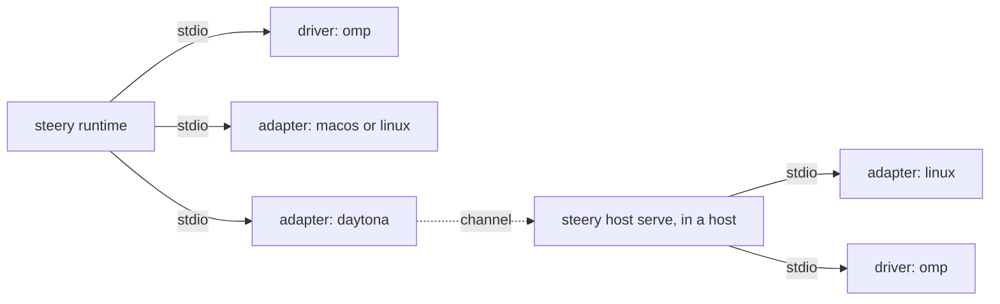

# The program protocol, version 12

This document is the one contract between Steery's runtime (`steery`) and every **driver**
and **adapter**. It is also the contract between the control of the runtime and a remote
host (§6). It is published under MIT in [steery-dev/sdk](https://github.com/steery-dev/sdk)
with `steery-sdk`, the Rust crate that implements it. It is also published with the JSON
Schema [`schema/protocol-v12.json`](schema/protocol-v12.json), which holds every shape below.
Steery's own drivers ([steery-dev/drivers](https://github.com/steery-dev/drivers)) and
adapters ([steery-dev/adapters](https://github.com/steery-dev/adapters)) are programs like
any other. The runtime knows no program by its id, and every program is added in the same
way (§7).

## 1. Programs

| Program | Connects Steery to | Wire `kind` |
|---|---|---|
| **driver** | one harness: an agent product | `harness` |
| **adapter** | one kind of machine: an operating system, or the hosts that it makes | `machine` |

An adapter **provides** one of two things:

- `processes`: an operating system. The adapter starts, finds, inspects and signals
  processes on the computer that it runs on. It also runs the runtime there as a service.
  Its id is the name of the system as Rust spells it (`std::env::consts::OS`: `macos`,
  `linux`). It answers that same name as `machine.os`. The runtime runs the adapter that is
  named for the system that the runtime runs on. It reads the adapter as missing where
  `machine.os` names another system.
- `hosts`: hosts, one for each conversation, which the service of a vendor makes (Daytona's
  cloud, for one). The adapter makes, starts, stops and deletes hosts. It gives a command
  whose standard input and output reach `steery host attach` inside a host. Inside the
  host, `steery host serve` uses the operating-system adapter of that host (`linux`) for
  its processes. A machine whose adapter makes hosts runs each conversation in a host of its
  own. It runs no conversation on the computer that runs it.



Three rules apply to every program:

1. **The runtime is its only client.** A program never talks to Steery's server. It never
   holds the key of the machine, and it never sees a signed answer.
2. **A program states facts and does what it is asked. It decides nothing.** The runtime
   decides, and asks: whether words go in, which conversation to resume, whether to stop a
   process.
3. **A program changes nothing in a harness but what `setup/plan` lists.** The runtime
   writes those entries itself and records them. The one other write is the `append` of a
   hook (§4.1), which the harness itself asks its hooks for.

## 2. Transport

- The runtime starts the program as a child process. It speaks JSON-RPC 2.0 to it, in
  UTF-8, one JSON object per line on standard input and output. A line holds no newline of
  its own, and it is at most 16 MiB. The side that reads a longer line skips it whole.
  Standard error is the log of the program, and the runtime keeps it.
- The runtime sends requests and notifications. A program answers requests and sends
  notifications. A program sends no requests.
- **Ids are strings the runtime chooses.** The program answers an id sent again, with the
  same method and parameters, from its first result. It never acts on it twice. A program
  keeps the answers to at least its last 256 ids.
- **Strict shapes.** Every params and result object, and every object inside one, has
  exactly the fields that this document gives it. A field that this document does not
  define is an error. A program answers such params with code `-32602`. The runtime reads
  such a result as `refused`. Values that the harness or a person wrote are any JSON: a
  tool's `input`, a hook's `document`, an entry's `value`. The runtime and the program pass
  them as they came. An optional field (marked `?`) is absent, never `null`. `null` is a
  value only where a row names it.
- **Times** are milliseconds since 1970, UTC, as integers. **Paths** are absolute.
  **Bytes** are base64 (standard alphabet, padded).
- **A refusal** is a JSON-RPC error with code `-32001` and
  `data: {"refused": <word>, "line"?: <one line for a person>}`. The word is one of §8. The
  runtime reads any other error as `refused`.
- **Unknown method:** code `-32601`. The runtime reads it as `selection-unsupported`.
- **A bad request:** code `-32600`. A program answers it to these:
  - a line that is not JSON or is over 16 MiB
  - a request sent before `initialize` is answered
  - an id sent again with another method or other parameters
- **Timeouts** are the runtime's, for each method (§9). The runtime drops a late answer.
- **Shutdown:**
  1. The runtime sends `shutdown`.
  2. It waits for the answer.
  3. It closes standard input.
  4. It sends SIGTERM to a program that still runs 5 s later.

## 3. `initialize`

`initialize` is the first request of the runtime. The runtime sends nothing else before the
answer to `initialize`.

```json
{"jsonrpc": "2.0", "id": "1", "method": "initialize",
 "params": {"protocol": [3, 4], "runtime": {"release": "7.0.0", "os": "linux", "arch": "x86_64"},
            "home": "/home/ada", "config": "/home/ada/.config/steery",
            "settings": {"DAYTONA_API_KEY": "…"}}}
```

`protocol` lists the versions that the runtime speaks. `settings` holds the values that the
person gave for the settings that the program declared (§3.4), and nothing else.

The answer is `{protocol, program, harness | machine, settings}`. It names one version: the
newest offered version that the program speaks (`steery_sdk::pick`). Thus a program on
version 4 answers 3 to a runtime that offers only 3. The runtime closes a program that names
a version that the runtime did not offer. It asks a program only the methods of the version
that the program named. `program` is `{id, kind, release, label, short, tint?, mark?}`:

- `id` is lowercase kebab-case, at most 64 characters. For a driver, it is what
  `Session.harness` names. For an adapter, it is the adapter of the machine. One computer
  has at most one program with a given id.
- `kind` is `harness` for a driver, which then answers `harness` (§3.1). It is `machine`
  for an adapter, which then answers `machine` (§3.2). It is never both.
- `label` (one line, at most 40 characters: `Claude Code`) and `short` (1 to 3 characters
  for a tile: `CC`) are what a person reads.
- `tint?` is the colour of the program on a tile, `#rrggbb` in lowercase. Absent: Steery's
  neutral tint.
- `mark?` is the mark of the program: the `d` of one SVG path in a 24 by 24 box, filled with
  the even-odd rule. It is at most 4096 bytes of path commands and numbers. Absent: a tile
  shows `short`.

Every surface where Steery draws a harness or a machine reads these from the program and
from nothing else. These surfaces are its apps, its web pages and its cards.

### 3.1 A driver

```json
{"protocol": 4,
 "program": {"id": "omp", "kind": "harness", "release": "1.0.0", "label": "omp", "short": "omp",
             "tint": "#6e62a8", "mark": "M4 4h16v16H4z"},
 "harness": {
   "levels": ["observe", "drive", "live"],
   "minimum": {"release": "18.4.12", "update": "omp update"},
   "sign_in": "run /login",
   "knowing": "…how an agent in this harness learns its conversation's id…",
   "transcript": "…one line on how its transcript file reads…",
   "identity": {"executables": ["omp"], "package": "@oh-my-pi"},
   "setup": {"reads_skills": true, "cuts_tool_text": false},
   "reader": {"sealed": {"tools": true, "mcp": false, "instructions": true,
                         "extensions": true, "history": true},
              "known": [], "unnamed": false},
   "facts": {"by_file": false, "resumes_in_place": true, "forks_beside": true,
             "keeps": {"model": false, "thinking": false}, "door": "plugin",
             "checks_idle": true, "worktrees": false, "acts": ["continue", "fork", "new"]},
   "hooks": [{"event": "UserPromptSubmit", "kind": "prompt", "via": "door",
              "says": ["context", "notice"]},
             {"event": "PreToolUse", "kind": "before_call", "via": "door", "says": ["calls"]}]},
 "settings": []}
```

| Field | What it says |
|---|---|
| `levels` | `observe` (§4.1), `drive` (§4.2), `live` (§4.3). Each level needs the one before it. The driver names `live` exactly when it names `facts.door`. |
| `minimum?` | `{release, update?}`: the oldest harness release that the driver speaks to, and the command that updates the harness. The runtime compares it with the `found.release` of `setup/plan`, and says the line itself. |
| `sign_in?` | What a person does to log in to the harness's own account. The person reads it on their phone and does it at the machine. It completes "{harness} is not logged in on {machine}: …". It is a command that they run in a terminal there, ``run `claude auth login` in a terminal``. It is never a command only inside the harness's own window. |
| `knowing` | How an agent in this harness learns the id of its conversation. Steery's skill carries it. |
| `lines?` | Who writes the lines of its sessions. `agent`: the agent, which Steery's skill and hooks tell how. `harness`: the harness writes them itself, so Steery tells its agent nothing about these lines. Absent: `agent` (version 9). |
| `hosted?` | The operations of Steery's catalog that the harness hosts as tools of its own, each by the name of its tool: `{"cards.put": "card", "sessions.describe": "describe"}`. Steery's skill and hooks name each one so. They name every other operation as Steery spells it. Absent: none (version 9). |
| `transcript?` | One line on how the transcript file of the harness reads, for a reader that gets one. Absent: the harness keeps no transcript file, and a carry refuses. |
| `identity` | How the runtime recognizes the processes and MCP calls of the harness (§3.3): `{executables, package?, session_variable?, call_meta?: {session, sub_agent?}}` (`call_meta`: version 8). |
| `setup` | `{reads_skills, cuts_tool_text, call_bound?}`. `reads_skills`: the harness reads Steery's skill from the entry that `setup/plan` lists. Where it is false, the runtime carries the whole skill in its MCP handshake. `cuts_tool_text`: the harness cuts the description of an MCP tool before its model reads it. So the runtime also says its escalation policies whole at `session_start`. `call_bound`: the longest time, in seconds, that the harness waits for one MCP call, where no entry can make it longer. The runtime answers a wait within it. |
| `reader?` | The one-shot reader (§4.2): `{sealed, known, unnamed}`. `sealed` says which of `tools`, `mcp`, `instructions`, `extensions`, `history` the reader shuts out (true) or still reaches (false). The runtime tells a person, and tries the most sealed reader first. `known`: models that the reader runs but that `models` does not always list. `unnamed`: the reader runs the harness's own model when it gets none. Absent: the driver has no reader. |
| `facts` | What the holder rule and offers read, below. |
| `hooks` | Every moment of the harness that the runtime reads (§4.1): `[Hook]`. |

`facts` is:

- `by_file`: a continue names a conversation by its transcript path, not by its id.
- `resumes_in_place`: a continue runs only in the folder that the conversation ran in.
  Where that folder is gone, the continue is refused `no-place`.
- `forks_beside`: a fork can run beside a live writer.
- `keeps: {model, thinking}`: what a continue keeps when nobody tells it. For a value that
  it does not keep, the runtime passes the last known value of the conversation.
- `door?`: how the runtime reaches a live conversation (§4.3):
  - `plugin`: Steery's plugin door (§4.4), which applies a model itself.
  - `picks`: the harness's own door, which applies a model itself.
  - `keeps`: the harness's own door, which keeps its own model.
  - Absent: no live door.
- `checks_idle`: the door itself checks that the conversation is idle as it takes words.
  So words that must go in only while nothing runs (`immediate`) can go through it.
- `worktrees`: `start` makes a fork or a new conversation in a new worktree when asked.
- `acts`: which of `continue`, `fork`, `new`, `hand` the driver does at all.
- `touches?`: the driver sends `sessions/touched` for each conversation that changes (§4.1).
  The runtime then sweeps none of its conversations. Absent: false (version 12).

A **Hook** is `{event, kind, via, says, waits?, env?}`:

- `event`: the harness's own name for the moment, unique in the list.
- `kind`: what the moment is:
  - `session_start`
  - `prompt` (a person's instruction went in)
  - `before_call`, `after_call`, `turn_end`, `session_end`
  - `permission` (the harness asks its person to allow a call)
  - `notification` (the harness tells its person something)
  - `sub_agent_start`
  - `changed` (what the conversation runs on changed: its model)

  The kind says what the agent does from then on:
  - `prompt` and `after_call`: working
  - `before_call`: waiting on the call
  - `turn_end`, `session_end`, `permission` and `notification`: nothing
  - `session_start` and `sub_agent_start`: no claim

  A `changed` moment says nothing about the state of the conversation, except in the state
  fields of its Moment.
- `via`:
  - `command`: the harness runs `<hook> <event>` (the `hook` of `setup/plan`) with its
    document on standard input.
  - `door`: the plugin sends the document of the harness over the door (§4.4).

  In both cases, the runtime reads the document with `hook/read`.
- `says`: the paragraphs that a moment of this event can give the agent. The runtime gives
  these paragraphs nowhere else.
  - `context`: Steery's paragraph for the conversation. At a `turn_end`, it makes the agent
    continue with it. At a `sub_agent_start`, it reaches the sub-agent.
  - `notice`: that words wait for the agent.
  - `calls`: a line about the shell command that the call runs.
  - `working`: a paragraph for a sub-agent in the middle of its work.
  - An empty list: the runtime only reads the moment.
- `waits?`: the seconds that the harness gives this hook before it continues without it, as
  `setup/plan` wrote it. The runtime answers within `waits - 90`. Absent: the runtime
  answers at once. One entry for each event carries the longest wait that the event needs (a
  call that asks the person, `Call.asks`). When a moment waits on nobody, the runtime answers
  it within 5 s, whatever `waits` says. Thus a long `waits` never holds an ordinary call.
- `env?`: names of variables of the hook's process that the driver reads
  (`CLAUDE_ENV_FILE`). The runtime passes their values in `hook/read` and `hook/answer`.

### 3.2 An adapter

```json
{"protocol": 3,
 "program": {"id": "daytona", "kind": "machine", "release": "0.1.0", "label": "Daytona",
             "short": "Dt", "tint": "#1f2937"},
 "machine": {"provides": "hosts", "keeps": "filesystem", "idle": "activity",
             "optional": ["archive", "keepalive", "expose"], "builds": true, "channel": "argv",
             "os": "linux"},
 "settings": [{"name": "DAYTONA_API_KEY", "secret": true, "required": true,
               "about": "An API key from app.daytona.io/dashboard/keys"}]}
```

`machine.provides` is `processes` or `hosts`. The rest of `machine` is the facts of that
kind:

- `processes`: `{os: "macos" | "linux", service: "launchd" | "systemd"}`.
- `hosts`:
  - `keeps`: what survives `hosts/stop` (`filesystem`, `memory`, or `volume`: only the
    folder in `persist?`).
  - `idle`: the vendor's own timer (`activity`, `ttl`, `none`).
  - `optional`: the optional methods that it has, by their last word (`archive`, `pause`,
    `fork`, `keepalive`, `expose`).
  - `builds?`: true where `hosts/ensure` takes a `source` of `{dockerfile}` (§5.2). Absent
    where it does not.
  - `channel`: `argv` (§5.2) or `stream` (§5.3).
  - `os`: the operating system inside its hosts (`linux`).
  - `unavailable?`: one line that says why this computer can get no host of this adapter,
    whatever the settings. It names what to install or change (`Daytona's channel runs ssh
    on this computer, and none is installed: …`). The runtime adds no machine of an
    unavailable adapter and offers none. It reads a machine that it runs as Missing, with
    the line. The adapter still refuses the methods that need what is missing, as the
    guard where they are used.

### 3.3 Names every program reads

The runtime and every program read these names in the same way.

- **A process runs as a harness** in one of two cases:
  - The file name of its first argument is one of `identity.executables`.
  - The file name of its first argument is `node` or `bun`, or begins with `python`. A later
    argument that does not begin with `-` must also match. Such an argument matches when its
    file name is one of `executables`. It also matches when its path components include the
    components of `identity.package`, in order and adjacent. (A package `@openai/codex`
    matches `…/node_modules/@openai/codex/bin/codex.js`.)

  Arguments are split on spaces, tabs and NULs.
- **`STEERY_STARTED=<pid>:<what>`** marks a harness process that was started for Steery.
  `<what>` is one of these:
  - `nothing`: it writes no conversation (a version, a model list, a reader).
  - `turn:<harness>:<external_id>`: a turn that continues that conversation.
  - `turn@<folder>`: the turn of a fork or of a new conversation, by the name of its turn
    folder.

  The runtime sets it on every process that it starts for a harness. To do this, it names
  `<what>` in `started` of the `process/start` of its operating-system adapter, which writes
  its own pid. A driver sets `<its own pid>:nothing` on every harness process that it starts
  itself. Nothing else sets it. Readers trust the value only where the parent of the
  process is `<pid>` and is not pid 1. A plugin does nothing in a process that the value
  marks `nothing`. A stop finds every process whose value names the turn that it stops,
  whatever its parent.
- **`STEERY_LEAD=<harness>:<external_id>`**: the plugin or hooks of a conversation put it on
  the processes that its agent starts. A harness process that inherits a lead that names
  another conversation is a sub-agent of that conversation. A harness can put its own id in
  its own process (`identity.session_variable`, `CODEX_SESSION_ID`). When a process inherits
  that variable, the runtime reads it as the same lead. The runtime reads the lead of a
  moment. A driver never reads it:
  - For a command hook, the runtime reads it from the environment of the hook process. It
    reads `STEERY_LEAD`, else a variable that the process inherited and that is the
    `identity.session_variable` of another driver.
  - For a door, the runtime reads `hello.lead`.
- **MCP request headers** name the conversation that an MCP call is made in:
  - `Steery-Harness`: a driver id.
  - `Steery-External-Id`.
  - `Steery-Sub-Agent`, where a sub-agent makes the call: the id of the sub-agent. The
    other two headers then name its lead.

  The values are trimmed. A call sends both of the first two headers or neither, unless
  that driver declares `identity.call_meta` (version 8).
- **An MCP call's `_meta`** names the conversation where one MCP client serves every
  conversation that the harness runs. There, no header can say whose call it is, so the
  harness itself puts the conversation in the `_meta` of each call. The driver declares the
  keys in `identity.call_meta`:
  - `session`: its value is the id of the conversation (for the call of a sub-agent, the
    lead of the sub-agent).
  - `sub_agent`: its value is the id of the calling sub-agent, where it is not that id.

  Its MCP entry then sends `Steery-Harness` alone. A call whose `_meta` holds no string at
  `session` names nobody.
- **The delivery marker** `steery-delivery:<name>` is in every set of words that Steery
  puts into a conversation. It matches only whole: the character after `<name>` is not a
  letter, a digit, `.`, `-` or `_`.
- **Which conversation a process or an MCP call is in.** The first match wins, in this
  order:
  1. The headers, or `Steery-Harness` with the `_meta` of the call.
  2. For the process and each of its parents up to 8, with a stop at pid 1:
     1. the `session_variable` in the environment of a process that runs as its harness
     2. an absolute path on its command line that is the transcript of a listed
        conversation
     3. the one conversation whose transcripts it holds open (two or more name none)

### 3.4 Settings

A program declares the settings that it needs: `{name, secret, required, about}`. The
person gives them once, by `--setting NAME[=VALUE]`, where the program is put to use:

- For an adapter that makes hosts: at `steery setup --adapter <id>` on a computer, or on
  Steery's web, where a cloud machine is added.
- For a driver: at `steery programs add` (§7).

When the person does not give a `secret` setting there, they type it at that terminal, with
no echo. It never leaves the computer. The runtime also asks there for any other setting
that the person did not give, or asks on the card that the new machine raises.

The runtime checks the values of an adapter with `hosts/list` against the vendor. It keeps
them in the Steery folder of the computer, for the user of the person alone (0600). It keeps
the values of a driver in its record (§7), 0600 too. A driver added again keeps each value
given before that is not given again. The runtime passes the values only in `initialize`. A
program never asks for anything else. Neither the runtime nor the program reads a declared
setting from the environment that the runtime runs in.

## 4. Driver methods

A driver answers the methods of its levels. A method that its facts rule out is unknown
(`-32601`):

- `hook/read` where the driver declares no hook
- `hook/answer` where no hook is `via: command`
- `stop`, `say` and `pick` where the door is `plugin`, because the runtime speaks
  that door itself
- `reader` and `reader/read` where `harness.reader` is absent

### 4.1 Observe

| Method | Params | Result |
|---|---|---|
| `setup/plan` | `{mcp_url, skill, hook, door, release, timeout, trusts?}` | `{found?: Found, refused?, entries: [Entry], notes: [string], install?: {argv, about}, needs?: [Need]}` (`needs`: version 5) |
| `sessions/list` | `{seen_since?, transcripts: [path], after?}` | `{sessions: [Session], excluded: [string], complete, cursor?, after?, gone?: [string]}` |
| `sessions/locate` | `{external_id}` | `{session: Session}`; refused `not-found` |
| `sessions/read` | `{external_id, sub_agent?, cursor?, tail?}` | `{cursor, events: [Event], more, reset, whole, after?}`; refused `not-found`, `refused` |
| `sessions/fold` | `{external_id, sub_agent?, cursor?, records: [Record], quiet}` | `{cursor, events: [Event], consumed}`; refused `selection-unsupported` |
| `hook/read` | `{event, document, env}` | `{moment?: Moment}` |
| `hook/answer` | `{event, document, env, answer: Answer}` | `{stdout, exit_code, append?: {path, text}}` |
| `needs/give` (version 5) | `{need, way, values: {name: value}}` | `{done: {line, env?}}` or `{next: Way}`; refused `not-found`, `refused` |
| `mcp/list` (version 4) | `{cwd?}` | `{servers: [{server, url?}], complete, watch: [path]}`; refused `no-binary`, `refused` |

**`mcp/list`** answers the MCP servers that the harness loads. Thus Steery can tell which
conversation or machine reaches a service.

- Without `cwd`: the person's own servers, which every conversation loads.
- With `cwd`: the servers that a conversation started in that folder loads, as the harness
  itself decides. These include the servers of its project files only where the harness
  reads those files (a trusted or approved folder). They include the person's own servers,
  less the servers that the harness disables there.

`server` is the name that the harness gives the server. `url` is for a server that the
harness reaches over a URL. It holds the scheme, host, port and path of that URL, and
nothing else (`McpServer::new` makes it). Nothing else of an entry leaves the machine: no
command, argument, environment, header, token or OAuth field. Of a server over standard
input and output, only its name leaves the machine.

`complete` is false where servers can also come from a place that the driver cannot read.
Examples are plugins, the connectors of an account, and configuration that an administrator
manages. `watch` names the files whose change changes the answer. The runtime asks again
when one changes, as for `models`. A driver can list through the harness's own command.
Such a driver refuses `no-binary` where the harness is not here. It refuses `refused`, with
the line of the harness, where the harness lists nothing.

**`hook/read`** reads the document of one hook, a string. The document is the standard input
of a command hook. Or it is the `document` of a `moment` frame of a door (§4.4), as its JSON
text. The driver reads both in exactly the same way. A plugin classifies nothing. Only the
driver decides what a call is, its group, and whether it asks the person. So the plugin
sends the payload of the harness as it got it. `env` is `{}` for a door moment.

**`setup/plan`** gets these params:

- `mcp_url`: Steery's MCP URL.
- `skill`: the Markdown of the skill.
- `hook`: the command line that a hook runs. The `event` of the hook is added to it as one
  more argument.
- `door`: the loopback door URL of the runtime (§4.4).
- `release`: the release of the runtime.
- `timeout`: the seconds that an MCP entry gives one call.
- `trusts?`: the folders of a host that an adapter made for its conversations (§5.2).
  Nobody opens the terminal of such a host to answer a harness that runs only in a folder
  that its person trusted. A driver whose harness asks for this trust plans each of these
  folders, and the folders under them, as trusted, as its person would. `trusts` is absent
  on a person's own computer, where nothing is trusted for them.

It answers these:

- `found?`: what it found (`{binary, release, root}`). Absent where the harness is not
  installed.
- `refused?`: one line on why Steery does not configure this harness here.
- `install?`
- the entries

`found.binary` is absolute. The harness that the runtime starts later is that one. A driver
looks for the executable of its harness on `PATH`. Then it looks in the folder that the
installer of its vendor writes it to (the README of each driver names it). Thus the driver
finds a harness that its installer just put in a folder that is not yet on `PATH`.

The driver gives `install` only where `found` is absent and the driver can install its
harness on this system:

- `argv` is the vendor's own installer. `argv` holds a vendor's documented `curl … | sh` as
  written: `["sh", "-c", "curl … | sh"]`.
- `about` is one line for a person. It holds the exact command line that `argv` runs, and
  where it installs the harness.

The runtime names no harness here. It shows both `about` and `argv`. It runs `argv` only
when a person agreed, in one of these ways:

- The person chose it at a terminal and said yes.
- The person passed `steery setup --install`.
- The person added a machine whose hosts an adapter makes (§5.2). Each host made from no
  source of its person's gets every harness that its drivers can install.

Nothing else installs a harness without a person. The runtime runs `argv` with the person's
environment and no standard input, through the operating-system adapter (`process/start`),
within 10 minutes. It keeps the output in `logs/` in the Steery folder of the host. Then it
asks `setup/plan` again. An installer that exits 0 and leaves `found` absent has failed.

**Needs** (version 5). A **Need** is `{id, title, line, ways: [Way]}`. It is what the
harness lacks on this host that only its person can give: a sign-in, a setting. It is never
an entry that Steery writes itself, and never an install. `id` is the same for that lack in
every plan. `title` is the short question of a card. `line` says what is missing and what
it stops. Both are in the driver's words.

A **Way** is `{id, label, about?, link?: {label, url, fills?}, fields: [{name, label,
about?, secret}], ends_at?}`: one way to give the need. The driver's pick comes first. The
runtime asks each need once, on one card of its person's, only while work on the machine
needs it. The card offers each way with its fields. The values of the picked way go to
`needs/give`. `link` is a page that the person opens first. `fills` applies only where the
page sends the browser back to a loopback address that the app that opened the page
catches. It names the field that this return fills. Nobody sees a `secret` after the
person types it.

`needs/give` answers one of these:

- `{done: {line, env?}}`: the need is met.
- `{next: Way}`: one more step (a sign-in that the driver started: its link and code). The
  runtime asks it on a card of its own before `ends_at`.

`env` holds variables that the runtime keeps for this harness on this machine, sealed at
mode 0600. From then on, on every host, the runtime adds them to the environment of the
harness's driver. It adds them in the same way to the environment of every turn and read
that the driver plans. `env` is empty where what the person gave stays in this host. The
runtime asks `setup/plan` again after each `done`.

The driver refuses `not-found` for a need or a way that this host no longer lacks. It
refuses `refused`, with one line, for values that do not give the need (a key that the
vendor refused, a code past its time). The person reads that line beside the way, which the
runtime asks again. A sign-in completes in the harness's own flow. The driver starts the
harness's own sign-in and gives it the code. It never signs in to a vendor itself. It keeps
nothing that a sign-in gives.

An **Entry** is `{path, format: "json" | "toml" | "text", at?, value, carries}`. `path` is
an absolute file. `at` is the place in it (a JSON Pointer or a TOML key path). Absent: the
whole file, and a `text` value is a string. `carries` lists what reaches the harness through
the entry: `mcp`, `skill`, `hooks`, `plugin`. One entry can carry several (pi's plugin
carries its MCP entry).

A JSON `at` can end in `/-`, the past-the-end index of JSON Pointer. Then the value is one
element of the array there:

- The runtime adds it once, beside the elements that the file holds. An equal element that
  is already there counts as it.
- The runtime gives it back by removing that element alone.
- The runtime makes the array and its parents where they are missing. It removes an array
  that is left empty.

A harness that keeps hooks in arrays that its person shares gets its hooks this way (Claude
Code's `settings.json`, Codex's `hooks.json`). The runtime merges each entry byte-exactly,
records it, and gives it back when the harness is removed. It also gives back an entry that
an earlier plan listed and this plan does not. Thus a driver that renames a file (a
versioned plugin copy) lists only the new one. The runtime writes nothing until every plan
of a setup run has answered.

**`sessions/list`** answers the conversations updated since `seen_since` (all of them where
it is absent). It also reads the transcripts that the moments of the harness named
(`transcripts`), which can be outside its own folders. A **Session** is:

| Field | What it says |
|---|---|
| `external_id` | The harness's id for it. |
| `cwd?`, `title?` | The folder that it runs in. Its title. |
| `created_at?`, `updated_at` | When it began (for a conversation continued over several files, when the first file began). When it last changed. |
| `transcripts` | Every file of the conversation on this host, oldest first. At least one where `harness.transcript` is given. None where it is absent (a harness that keeps its conversations in another place, read through `sessions/read`). A path is always a local file that the runtime can read and match against processes. |
| `parent?` | The conversation that it was forked from, where it names one. A file that only continues the same conversation is not a fork. |
| `app` | It started in the app of the harness, not in a terminal or a program. |
| `sub_agents` | `[SubAgent]`: the sub-agents that work in it. |

A **SubAgent** is `{external_id, lead?, name?, task?, started_at?, started_by?,
transcripts}`:

- `lead`: the sub-agent that started it. Absent: the agent of the conversation itself
  started it.
- `name`: its name or role.
- `task`: the first line of what it was asked.
- `started_by`: the id of the call that started it.

The driver never lists a sub-agent as a session. It also does not list a run with no person
at it (a headless run, a program that drives the agent). `excluded` names the ids whose
every transcript is one of those. Thus the runtime does not read a missing one as gone.
`complete` is false where some file named its conversation ambiguously. A conversation
absent from a complete listing is gone.

**Changes only** (version 10). A driver can name each listing that it answers by a
`cursor`. The runtime then gives that cursor as `after` in its next call. The answer to that
call gives only what changed since the listing of `after`. The whole listing is that
listing with these changes:

- `sessions`: each conversation that is new or that the driver lists otherwise now.
- `excluded`: each id that it excludes now and did not exclude then.
- `gone`: each id that it listed then, as a conversation or as excluded, and that it lists
  now as neither. A conversation that is now older than `seen_since` is gone too.
- `complete` says the same of the whole listing as it does without `after`.
- `after` is the `after` of the call. It says that the answer gives only what changed.

A driver that does not keep the listing of `after` answers with the whole listing, without
`after`: for example, a driver that started again. Every answer of a driver that names its
listings has a `cursor`, the one of a whole listing too. A driver that names none answers
each call whole. The runtime gives `after` only to a driver that picked version 10 or newer,
and only a cursor that driver gave. `steery_sdk::listing` holds both halves: a driver's
`Changes`, and the runtime's `Listed::then`.

**Touches** (version 12). A driver whose `facts.touches` is true sends `sessions/touched
{external_ids}` with no request, one for each change that it sees. Each id is a
conversation whose thread, or the thread of one of its sub-agents, changed. `["*"]`
(`SessionsTouched::EVERY`) touches every conversation that the driver listed. The runtime
reads the conversations of such a driver only when a touch names them, and never sweeps
them. It lists the driver again in these cases:

- The runtime starts, or the driver starts again.
- A touch names `*`.
- A touch names an id that the last listing of the driver does not hold.

Thus a new conversation still appears. A driver that picked 11 or older names no
`touches` and sends no touch. The runtime sweeps its conversations.

**`sessions/locate`** answers one conversation by its id, however old it is.

**`sessions/read`** answers the events of a conversation, or of one of its sub-agents,
after `cursor`:

- `cursor` is opaque, and it survives a restart of either side. It points between whole
  records. A record that its newline did not end yet stays for the next read.
- `tail` (bytes) reads only the newest records within that many bytes of the end. It gives
  a look at where a conversation stands. Its `cursor` continues from the end.
- `more`: events remain past this answer. The runtime reads again from `cursor`.
- `reset`: the history of the conversation is no longer what the old cursor followed. Its
  file was rewritten or replaced. Or a conversation kept as a tree went back to an earlier
  entry and took another branch. These events start again from the beginning of the
  history that it has now. The runtime drops what it built from the old cursor. Tokens are
  also spent on a branch that the conversation left. A driver gives them as `tokens` events
  with `count: response` on the history that it has now, so they are counted once.
- `whole`: the events start at the beginning of the conversation.
- `after`: the id of the newest record such that the driver read every record written
  before it. On a tree, this is every record of the current history up to it, and every
  other record written before it. The runtime uses it as `welcome.entries.after` of the
  plugin door (§4.4) when it goes back to the door. It is absent after a `tail` read, and
  where the driver read no record with an id.
- `cursor` can be one that `sessions/fold` answered. Then the read continues after the last
  record that the fold consumed, where the transcript holds that record on the current
  history. Where the transcript holds it off that history, the answer is `reset`. Where the
  transcript does not hold it yet, the answer has no events.
- The driver refuses `not-found` where the conversation or sub-agent is not here. It refuses
  `refused`, with its line, where it cannot read this one conversation as the harness keeps
  it. An example is a transcript whose history reaches a record that the host does not
  hold. The driver does not read it as a shorter conversation. Both refusals are answers
  about that conversation, never a fault of the driver.

**`sessions/fold`** answers the events of records that came from the `entries` frames of
the plugin (§4.4). It is for a driver whose `facts.door` is `plugin`. The driver folds the
records exactly as `sessions/read` folds the same records from the transcript. Thus either
method feeds the events of one conversation with the same ids. A driver whose door is not
`plugin` refuses `selection-unsupported`.

- A **Record** is `{id, value?}`: the harness's id for one of its records, and the record
  as the harness keeps it. `value` is absent for a record over 8 MiB. The driver then reads
  that one record from the transcript by `id`.
- `records` follow `cursor` (absent: they start at the first record of the conversation).
  They come in the order that the harness appended them, every branch of a tree included.
  Each response is folded once, and a move to another branch needs no `reset`.
- `quiet`: milliseconds since the newest record arrived. A driver can hold back a record
  until more records follow (a failed request that the harness can retry). Such a driver
  holds the record while `quiet` is short, as `sessions/read` holds it while the transcript
  is new.
- `consumed`: how many of the leading records the events say. The runtime gives the others
  again, with the records after them, to the next fold from `cursor`.
- `cursor` is opaque, and it survives a restart of either side. It is also a
  `sessions/read` cursor.

An **Event** is one of:

| `type` | Fields |
|---|---|
| `turn_began` | `at, turn?` |
| `turn_ended` | `at, turn?, state: finished \| failed \| interrupted, failure?: Failure` |
| `words` | `at, id, voice: person \| agent \| thought \| tool \| summary, text, message?, call?, clips: [Clip]` |
| `rollback` | `at, turns`: the harness took back the newest `turns` person instructions |
| `call_began` | `at, call: Call` |
| `call_ended` | `at, id, ok, chars, tail?, waited?` (`waited`: version 6) |
| `tokens` | `at, count: response \| total, response?, model?, input, cached, cache_write?, output, reasoning, context_left?` |
| `model` | `at, model, provider?, thinking?` |
| `sub_agent` | `at, external_id, call?, state?: running \| finished \| failed \| interrupted, error?` |
| `fork` | `at, parent`: every event before it is the parent's history, copied into this conversation |
| `compacted` | `at, id, by: Compactor, tokens_before?, tokens_after?`: the harness compacted the context |

- `turn` is the harness's id for the turn. A turn ends `interrupted` where the harness wrote
  no end and its process is gone. It also ends `interrupted` where it was stopped (pi
  records `aborted`).
- `words`: `id` is stable for that message. The voices are:
  - `person`: only what a person typed. It is never an envelope, injected context or a
    message of the harness itself.
  - `agent`: the answer of the agent.
  - `thought`: its reasoning or progress, where the harness writes it as text.
  - `tool`: the text of the result of a call, given after the `call_ended` of that call.
    `call` names the call. The input of a call is `call_began.call.input`, and it is never
    repeated as words.
  - `summary`: a summary that the harness made of earlier history.

  `message` is the harness's key of the message that the words are of, where it is not
  `id`. It is the identity of the reply, as the `message` of a live frame names it (§4.4).
  A `model` event without `thinking` says nothing about thinking (omp records none).
- A **Clip** is something that the words of a person carried, tagged by `kind`:
  - `bytes {data, media_type?, name?}`
  - `file {path, media_type?, name?}`: bytes kept in a file here
  - `path {path, name?}`: a file that the person named
  - `link {url}`
- A **Call** is `{id, tool, input, group, server?, steery?, asks?, parent?, response?}`:
  - `tool`: as the harness spells it. An MCP tool is `mcp__<server>__<tool>`.
  - `input`: as the harness wrote it (`null` where it gave none).
  - `group`: one of `shell`, `files-read`, `files-edit`, `search`, `web`, `browser`,
    `code`, `agents`, `plan`, `ask`, `steery`, `memory`, `harness`, `media`, `custom`,
    `mcp`. With `mcp`, `server` is the MCP server as the harness names it.
  - `steery`: the name of Steery's own tool, where the call is one (`requests_create`).
  - `asks`: present where the call waits on the person inside the harness
    (`{"questions": [Question]}` or `{"plan": text}`).
  - `parent`: the call that it runs inside.
  - `response`: the model response that made it.

  A harness can make a call through another of its tools (omp's `write` to an
  `xd://<tool>` device). The driver reports it as the call that it makes. `tool` is the tool
  of the device. `input` is its arguments as the device reads them.
- A **Question** is `{question, header?, multiple, options: [{label, description?,
  preview?}]}`.
- `call_ended`: `chars` is the length of the text of the result. `tail` is its last 8
  lines. `waited` (version 6) names earlier calls of this conversation by their
  `call_began` ids. These are the calls whose work this call waited on:
  - Such a call returned while the work that it started continued to run. That work is a
    command sent to the background, a service, or a sub-agent run in the background.
  - This call waited for that work, read its output, or polled it until it returned.
    Examples: omp's `wait` on its background jobs, Claude Code's `BashOutput` of a shell,
    Codex's `write_stdin` to a running session.

  `waited` is the harness's own record of what the call waited on, read from its
  transcript. It is empty where the call waited on nothing that it can name. Steery counts
  the time that a call waited as time spent on the work that it waited on.
- `tokens`: `input` counts every token read, cache reads and writes included. `cached` and
  `cache_write?` are parts of `input` (absent: the harness does not say). `reasoning` is part
  of `output`. `count: response` is the count of one response alone, which `response` names.
  A response said twice is counted once, at its largest. `count: total` is the running
  total of the whole conversation (Codex). `context_left` is the share of the context window
  that is left after it, 0 to 1.
- `sub_agent` is what the conversation said about one of its sub-agents: that `call`
  started it, or that it ended.
- `compacted`: the harness replaced the context before it with a summary. `id` is the
  harness's id for its record of it. A **Compactor** is tagged by `kind`:
  - `harness {reason?}`: the harness did it on its own. `reason` is `threshold` where the
    context reached the limit of the harness. It is `overflow` where the model refused a
    call as over its limit. It is `idle` where the harness compacts a conversation left
    idle. Else it is the harness's own word. It is absent where the harness records none.
  - `person`: its person asked (`/compact`).
  - `steery {compaction}`: the `compact` ask of the door (§4.4), by its `id`.

  `tokens_before` and `tokens_after` are the tokens of the context just before and just
  after, summary included, as the harness counted them. They are absent where the harness
  records none. History that a fork copied says none.
- A **Failure** is `{kind: sign_in | rate_limit | context_full | other, line, service,
  http_status?, code?, retry_at?, provider?, model?, thinking?}`:
  - `sign_in`: the harness could not sign in to its model service (a 401, or the harness's
    own code for it).
  - `rate_limit`: the service refused for a limit, and takes requests again later (429,
    503, 529, or the harness's own code). `retry_at` is present where the service said when.
  - `context_full`: the prompt is over the limit of the model, and no turn of it runs again.

  `service`: the failure came from the model service, not from the harness. `line` is the
  harness's own words, one line. Only the final outcome of a turn makes the turn failed. A
  failure that did not end the turn is no event.

A **Moment** is what `hook/read` answers:

| Field | What it says |
|---|---|
| `event` | The `Hook.event` that it is. |
| `external_id` | The conversation that it is in. For the moment of a sub-agent, the conversation that the sub-agent works in. |
| `sub_agent?` | The sub-agent whose moment it is. |
| `at?` | When it happened. |
| `cwd?`, `transcript?` | The folder that it runs in. Its transcript file, where the harness keeps it outside its own folders. |
| `call?` | The `Call` that it is at (`before_call`, `after_call`, `permission`). |
| `ok?` | At an `after_call`: whether the call succeeded. |
| `outcome?` | At a `turn_end`: `finished`, `failed`, `interrupted`. |
| `continued` | At a `turn_end`: a hook already made this turn continue once. |
| `person_exited` | At a `session_end`: the person left at the prompt. The harness's own word says that they are done. |
| `prompt?` | At a `prompt`: the instruction, where the harness gives it. |
| `context_left?` | 0 to 1. |
| `model?`, `thinking?` | The model that it runs on now and how hard it thinks, in the harness's own words, where the moment says them. |
| `failure?` | At a `turn_end` whose `outcome` is `failed`: the `Failure`, where the harness says why. |
| `suggestions?` | At a `permission`: the harness's own ways to allow such calls from now on, in its order. Each is `{label, about}`. `label` is what a person reads for it (`Always Bash(cargo check:*)`). `about` is one line on how far it reaches (`this project, for you`). `always: {suggestion: n}` is the n-th. Absent: none. |

`hook/read` answers no `moment` for a document that is not a moment that Steery carries.

`context_left`, `model`, `thinking` and `failure` are state, never events. No transcript
record has the id of the moment. So the runtime takes each one as the state of the
conversation now. Each one wins over what the events last said, and what the door says
wins over each one (§4.3). The runtime counts nothing from them. A moment without one of
them says nothing about it.

An **Answer** is what the runtime decided: `{say?, decision?, lead?}`.

- `say` is a paragraph for the agent.
- `decision` is `{"allow": {reason, always?}}` or `{"deny": {reason}}`. `allow` lets the
  call go without the harness asking. `always` is `{"suggestion": n}` (one of the
  `suggestions` of the moment), `"tool"` (this tool for the rest of the session), or
  `"everything"`. `deny` blocks the call. The reason is what the agent reads (the answer of
  a person to a question, or why a plan was not approved).
- `lead` is the `STEERY_LEAD` value for the later processes of the conversation to
  inherit.

An empty Answer says nothing. `hook/answer` turns it into what the harness reads:

- the standard output of the hook (empty: print nothing)
- its exit code
- `append`: a line that the hook adds to a file that the harness named for it (Claude
  Code's `CLAUDE_ENV_FILE`)

### 4.2 Drive

| Method | Params | Result | Refusals |
|---|---|---|---|
| `held` | `{external_id}` | a Holder, or `{look: {transcripts, strays, beyond?}}` | none |
| `idle` | `{external_id}` | `{sample?: Sample}` | none |
| `models` | `{}` | `{models: [Model], unlisted?: {thinking}, watch: [path], signed_in?: bool}` | `no-binary`, `refused` |
| `start` | `{act, external_id?, cwd, folder, worktree, model?, thinking?, reads}` | `{argv, env, cwd, stdin: "words" \| "none" \| "held", inbox}` | `not-found`, `no-place`, `model-missing`, `selection-unsupported`, `no-binary`, `start-failed` |
| `turn/read` | `{turn, stream: "stdout" \| "stderr", line, delivery?}` | `{named?, took?, ended?: {state, error?}, refused?, events: [Event], title?}` | none |
| `stop` | `{external_id, holder, say?}` | `{stopped, proof?}` | `not-stopped`, `other-turn` |
| `receipt/mark` | `{external_id}` | `{mark}` | `selection-unsupported` |
| `receipt/find` | `{external_id, mark, delivery}` | `{found, owner?}` | `refused` |
| `reader` | `{system?, model?, thinking?, tools: "none" \| "read", cwd, asked}` | `{argv, env, cwd, stdin: "words" \| "none", files: [{path, content}], read: "whole" \| "events"}` | `no-binary`, `model-missing`, `selection-unsupported` |
| `reader/read` | `{output}` | `{text}` | `no-answer` |
| `terminal` | `{external_id, cwd, holder?}` | `{command, app?, line?}` | `not-found` |

**`held`.** A **Holder** is `{"nobody": {proof}}` or `{"person": {door?: "picks" |
"keeps", stop}}`. `stop` is one of these:

- `{"owner": token}`: only the owner of the conversation in the harness can stop it,
  through the harness. Examples are a Codex window or app server, and a Claude Code
  background job. `token` is opaque, at most 1024 characters. The runtime keeps it and
  gives it back in `stop` and `receipt/find`. `{"owner": null}`: the owner runs no turn now.
- `{"process": {pid, process_start, certain, how}}`: that process holds it. `certain` is
  false where the driver could not prove that the process is the holder. `how` is a few
  words that a person reads after "holds it" (`in a terminal`).
- `{"beyond": line}`: a place that the runtime cannot reach holds it, said in one line.

`nobody` needs a proof that the driver can name: the harness's own registry, or no process
that writes the transcript. A driver that cannot prove absence answers `process` with
`certain: false`. A driver that knows only where to look answers `look`, with the
transcripts of the conversation and `strays`. A stray is a process that runs as the harness
and that no door, turn or `STEERY_STARTED` answers for. `strays` is true where a stray can
hold the conversation without holding its transcript open. The runtime then does these
steps:

1. It asks the operating-system adapter which processes hold those files or name them on
   their command lines.
2. It adds the knowledge of the plugin door (§4.4).
3. It reads a stray as `certain: false`.

`beyond` is `[{arg?, line}]` (absent: none). It applies to a process that holds or names the
transcripts. The runtime reads such a process as `{"beyond": line}` when the process has an
argument exactly equal to `arg`, or always where `arg` is absent. The runtime never signals
a process that it reads as `beyond`. Examples are Codex's `app-server`, which also serves
every other thread, and a Claude Code that its own registry does not name.

**`idle`** answers what the driver can prove of a conversation now, where no door says it.
A **Sample** is `{state: running | finished | failed | interrupted, observed_at,
started_at?, ended_at?, model?, thinking?, error?, vacant, if_unheld}`:

- `vacant` says that nobody is in the conversation at all. An idle window is not vacant:
  its person possibly reads it now.
- `if_unheld` says that the sample is true only if no process does one of these:
  - holds its transcripts
  - names one of them on its command line
  - runs as a stray, where `held` says `strays`

  The runtime checks this before it uses the sample.

With no `sample`, the driver cannot say. Unknown is never idle.

**`models`.** A **Model** is `{provider?, model, label?, thinking: [string], cost?}`. The
default model of the harness comes first. `model` is as the harness spells it. `thinking` is
its levels, in the harness's own words. `cost` is US dollars for each million input tokens,
where the harness says it.

- `unlisted` says that the harness also runs models that it does not list. The runtime
  offers such a model, seen in a conversation, with `unlisted.thinking`.
- `watch` names the files whose change changes the list (configuration, sign-ins, a model
  cache). The runtime asks again when one changes, and at least every 10 minutes.
- `signed_in` is what the harness itself says of its own account here, at the time of this
  listing. The driver asks the harness in the harness's own way (Claude Code:
  `claude auth status`). `true` is signed in, and `false` is not. It is absent where the
  driver cannot tell.
- With `false`, the harness reads not logged in on this machine, and `sign_in` (§3.1) says
  what the person does. `true` clears every failure to sign in that the runtime saw there
  before it. Thus a person who logged in outside Steery is not held signed out until a run
  succeeds. A driver that can tell lists its sign-in files in `watch`, so the runtime sees a
  login at once.
- The driver refuses `no-binary` for a harness that is not on this machine. It refuses
  `refused`, with the line of the harness, for a list that it cannot read (its person must
  sign in first). The runtime keeps the last list.

**`start`** starts nothing: it answers a launch plan. The runtime made the `folder` of the
turn before it asks `start`. The runtime also does these steps:

1. It writes the words to the folder.
2. It adds `STEERY_STARTED`, and `STEERY_COMPACT` where it compacts the conversation first
   (§4.4).
3. It starts the plan detached through the operating-system adapter (§5.1).

Thus a turn outlives a restart of the runtime, and the stop ladder can prove that it is
gone. With `stdin: "words"`, standard input is the file of the words. `reads` are folders
outside `cwd` that the turn reads. `worktree` asks for a new worktree for a fork or a new
conversation, where `facts.worktrees`. `start` first checks what it can check without a
process (omp: that the model is an exact entry of omp's own list). Where that check fails,
it refuses before anything runs.

With `stdin: "held"`, the runtime starts the process with a standard input that never ends
(`process/start` `held`). It discards the standard output of the process. When a copy says
`hello` from that pid, the runtime hands the words through the plugin door (§4.4). It keeps
the process after the turn.

Some harnesses must get words during a turn (Codex's app server, Claude Code's background
jobs). Such a harness gives a plan that runs the driver's own binary in a turn mode. That
plan answers `inbox: true`, and binds a unix socket `inbox` in the folder of the turn. The
runtime then does these steps:

1. It connects.
2. It writes more words for the running turn.
3. It closes its writing side.
4. It reads one line back: `heard` where the harness took the words, or else the harness's
   words. The runtime reads the harness's words as it reads `refused`.

A refused connection means that the turn ends now.

**`turn/read`** reads one line of the output of a turn. `turn` names one run. The runtime
gives every line of the run in order from the first, under that name, and again after a
restart. Thus a driver can keep state across lines.

- `named` is the conversation that the harness named.
- `took` is false on a line that names the conversation before the harness took the words.
  It is true on the line that shows that the harness took the words that carry `delivery`.
- `ended` is how the turn ends, where this line says so. A later line can change it, but a
  line written after the end says nothing.
- `refused` is the refusal word that a line of standard error means.

The runtime reads a turn as taken when the turn is named. The exception is a turn whose
lines said `took: false` and never `true`. Until the runtime reads the turn as taken, its
`delivery` and the words of the session behind it wait. A turn that ends first delivered
nothing. The runtime stops a turn that writes nothing for 10 minutes before the runtime
reads it as taken.

`events` are the events of the named conversation that the line says (§4.1). They carry the
stamps that the harness put on the line, and they come before the runtime reads the
transcript. Each event is one that `sessions/read` gives as the same fact under the same id:

- `turn` of `turn_began` and `turn_ended`
- `id` of `words`
- `call.id` of `call_began` and `id` of `call_ended`
- a `count: total` of `tokens`, by its numbers

Thus the runtime folds the event once, whichever comes first. A fact whose id the transcript
cannot give again is not an event here. The read of the transcript stands for that fact
(Codex: the words of a person, a compaction). A `model` event has no id. A `model` event
stamped before the model that the runtime already folded does not replace it. `title` is the
title of the conversation as the harness named it on this line. The newest title wins over
the title that `sessions/list` gives.

**`stop`** is the graceful step only: the harness's own way to end a turn, for an `owner` or
a `process` holder. The runtime sends the signals after it, through the operating-system
adapter. It sends them only to a process that it checked against the kernel. For a
`process` holder, it sends them wherever that process still runs, whatever `stopped` says.
`stopped` says that this step ended the turn. A harness with no graceful stop of its own
answers `{stopped: false, proof}`, with the line that says so. `proof` is the driver's one
line of evidence (the turn that it ended and the state that the turn reached). The runtime
records it with the stop.

`say` (version 7) is the `id` of a `say` that the runtime gave the driver (§4.3). With it,
`stop` stops only the turn that those words began. It cancels Steery's own words, never the
words of the person. The driver ends the turn in the harness's own way. It answers `stopped`
true when the turn ended, and `{stopped: false}` where no turn runs. It refuses
`other-turn` where the running turn is not one that the say began, or where the driver
cannot tell. Then nothing is stopped. With `say`, the runtime sends no signal after the
step, whatever the driver answers: this step is the whole stop.

**`receipt/mark`** and **`receipt/find`** prove that words went in where the door could not
say so. This happens in two cases:

- `say` answered `took: false`.
- A plugin door answered `no-answer`: its timer ran out while the harness still held the
  words in its queue.

The two methods follow these rules:

- `mark` is an opaque point in the conversation, taken before the runtime sends the words.
  `selection-unsupported` says that there is no such point here. Then the word of the door
  is the receipt.
- Behind a plugin door, the word of the door that it took the words stays the receipt. The
  runtime looks after the mark only when the door gave no such word.
- `receipt/find` looks after `mark` for the person input that carries the delivery marker
  `delivery` (§3.3). It answers `found`. Where a turn of the harness's owner took the input,
  it also answers that `owner` token. Where two inputs carry the marker, `receipt/find`
  refuses with `refused`.
- Neither method changes anything.

**`reader`** plans a one-shot read. Its params are:

- `system`: the instructions. Absent: the harness's own.
- `model`: absent: the harness's own model, where `harness.reader.unnamed`.
- `thinking`: a level that `models` lists for that model. Absent: the driver's own level
  for a read. A level that the harness refuses is `selection-unsupported`.
- `tools`.
- `cwd`: a private folder, or the place that the reader looks at.
- `asked`: the text that the reader reads.

The runtime does these steps:

1. It writes `files` first (paths relative to `cwd`).
2. It gives `asked` on standard input, where `stdin` is `words`.
3. It ends the read after 240 s.
4. It reads at most 512 KiB of output.

With `read: "whole"`, the output is the answer. With `events`, the runtime gives the output
to `reader/read`, which answers the text in it.

**`terminal`** answers these:

- `command`: the command line that opens the conversation in a terminal, quoted for a POSIX
  shell. The driver gives it where nothing but the person holds the conversation (`holder`
  as `held` said).
- `app`: the URL that opens the conversation in the harness's app.
- `line`: what a person reads about it.

### 4.3 Live

A driver reaches a live conversation in one of two ways. It says which way in `facts.door`:

- **`plugin`: Steery's plugin door.** The harness loads a plugin, which `setup/plan` writes
  like any other entry. The plugin dials the loopback door of the runtime and speaks the
  door protocol (§4.4). The runtime speaks it directly, and the driver answers no live
  method. omp and pi work this way.
- **`picks` or `keeps`: the harness's own door.** The driver answers the methods below
  through what the harness offers (Claude Code's inbox socket, Codex's app server).

| Method | Params | Result | Refusals |
|---|---|---|---|
| `say` | `{external_id, words, mode: "steer" \| "queue" \| "immediate", id?}` | `{took}` | `no-door`, `no-answer`, `harness-busy`, `refused` |
| `pick` | `{external_id, model?, thinking?}` | `{model?, thinking?}` as read back | `model-missing`, `selection-unsupported` |

`steer` goes into the running turn. `queue` goes after it. `immediate` goes in only where
nothing runs. Else the refusal is `harness-busy`, and nothing is handed over. `took` is true
where the driver saw the harness take the words. It is false where the driver handed them
over with no confirmation. The runtime then looks with `receipt/find`.

`id` (version 7, where the runtime always gives it) names the say. It is the name of the
delivery that its words carry (§3.3). For words of no delivery, it is a name of the
runtime's own, as the say of a plugin door is named (§4.4). The driver names it in
`turn.says` of the turn that took the words. It also names it in `settled[].says` when that
turn ends. A `stop` that names it stops only that turn (§4.2). A turn that took the words of
two says names both.

A driver whose door is `picks` or `keeps` sends `session/changed {external_id, state}` with
no request. `state` is a **LiveState**, the same shape that the `state` frame of the plugin
door carries:

| Field | What it says |
|---|---|
| `turn?` | `{began_at, says: [string]}`: a turn runs, and it began at `began_at`. `says` holds the ids of the `say`s that the turn took as Steery's. For a driver, these are the `id` that each `say` gave (version 7). |
| `idle?` | The door checked that the conversation is idle. Absent: it cannot say. |
| `pending?` | Words wait to go in. |
| `typing?` | The person's editor holds text. Absent: it cannot say. |
| `compacting`, `retrying` | The harness compacts its context now. The harness waits to retry a request. |
| `retry?` | `{attempt, of?, error?}`: while the harness waits to retry, the try that failed. `attempt` is which try it was (the first is 1). `of` is how many tries the harness makes before it stops. `error` is what went wrong, in its own words (at most 600 characters). Absent where the harness said nothing of it. |
| `jobs` | Background work that runs in the process and ends with it: jobs that it runs and results that wait to be told. Absent: none. |
| `model?`, `thinking?`, `context_left?` | What it runs on now. `context_left` is the share of its context window that is left. |
| `calls` | `[{id, tool, since, children: [{id, tool}], jobs?: [{label, since, output?, output_at?}]}]`: the top-level calls that run, oldest first, with the calls that run inside each. Each `tool` is named as a Call names it (§4.1). Steery's own tools are `mcp__steery__<tool>`. `jobs`: the background jobs that a call waits on and that still run, oldest first, at most 8. `label` is what the harness calls the job (often its command, at most 120 characters). `since` is when it began. `output` is its newest line of output or its stage (at most 200 characters). `output_at` is when that line last changed. Absent: none. |
| `ended` | `[{id, at}]`: top-level calls that ended lately, oldest first, at most 64. Their times are the true ends of the calls, and they win over the times of a transcript. |
| `dialog?` | `{kind: select \| confirm \| input \| editor \| custom, title, since}`: the harness's own dialog, open in front of the person. |
| `settled` | `[{began_at, at, says, failed, error?}]`: turns that Steery's words began and that ended, at most 16. `says` is as `turn.says` named them. |

A conversation is idle where all of these are true:

- `idle` is true.
- No turn runs.
- Nothing is pending.
- `typing` is false.
- The harness is not in a compaction or a retry.

### 4.4 The plugin door, version 1

A plugin door is a WebSocket. The plugin of the harness dials it on the loopback listener of
the runtime, at the `door` URL that `setup/plan` gave (`ws://127.0.0.1:<port>/door`). It
carries no credential, because the listener is loopback only. One connection is one
conversation in one process. The door has its own version, independent of the release of
the runtime.

**Frames** are WebSocket text messages. Each frame is one JSON object with its type in `t`,
at most 16 MiB. The receiver drops a frame that it cannot read, or whose `t` it does not
know. The connection stays. Every time is in milliseconds since 1970.

**Hello.** The first frame of the plugin, within 5 s:

`{t: "hello", door: 1, harness, pid, session_id, mode, lead?, state?, cwd?}`

- `door`: the door version that the plugin speaks.
- `harness`: the id of a driver whose `facts.door` is `plugin`.
- `pid`: the harness process.
- `session_id`: the conversation that this copy is in. For a sub-agent, it is the
  sub-agent's own id.
- `mode`: `tui` or `rpc`, where a person, or a program that draws for a person, is at it.
  `json` or `print`: a one-shot run, whose process ends with it. A process that the runtime
  started held (§4.2) says `rpc`.
- `lead?`: `{harness, external_id}` where the copy is a sub-agent's copy: the conversation
  that it works in. A copy that cannot name its lead opens no door.
- `state?`: a LiveState (§4.3), as `state` frames send it.
- `cwd?`: the folder that the conversation runs in now, as the `Moment.cwd` of its moments
  says it. Until a moment comes, the runtime uses this folder when it opens or hands over
  the conversation. A runtime older than this field refuses a hello that carries it (4400).

The runtime answers `{t: "welcome", door: 1, entries?: {after?}, live?}`, or it closes with
a code. A plugin that gets a welcome to another door version sends nothing more. It waits
for the runtime to close. `entries` is present where the runtime takes the records of the
harness. `after` is the id of the last record that the runtime holds. It is absent to start
at the first record of the conversation. `live: true` is present where the runtime takes
`live` frames.

| Code | Why | The plugin |
|---|---|---|
| 4400 | The first frame was not a readable hello, or `harness` names no plugin driver | does not redial until its harness restarts it |
| 4409 | The runtime does not speak `door` | redials after 5 s. By then, the harness can have loaded a newer plugin. |
| 4410 | A newer connection from the same `pid` and `session_id` replaced this one | does not redial |
| 1000 | The plugin closes: its conversation ended or moved | |

After any other drop, the plugin redials after 250 ms. The wait doubles each time, to at
most 2 s. After a welcome, the wait starts again from 250 ms. For 3 s after the runtime
starts to listen, it reads a conversation with no door as reconnecting, never as nobody's.

**Liveness.** The runtime sends a WebSocket ping every 15 s. It drops a connection when it
heard nothing from it for 30 s, or when a send to it takes over 30 s. The plugin answers
pings and sends none. A drop answers `no-answer` to every ask in hand.

**Who a copy is.** A copy with a `lead` is the copy of a sub-agent. It takes no words, no
pick and no stop. The runtime files its moments under the conversation of its lead. A copy
without a lead takes words and picks where its mode is `tui` or `rpc`, or where a turn runs.

**Plugin to runtime.**

| Frame | Fields | The runtime answers |
|---|---|---|
| `state` | `state`: a whole LiveState. The plugin sends it when it changes, at most every 100 ms, and again after welcome. | nothing |
| `moment` | `id, event, document`: a moment of a hook `via: door`. `event` is its `Hook.event`. `document` is the hook payload of the harness as the plugin got it. The runtime reads it with `hook/read` (§4.1). | `{t: "answer", id, ok: {say?}}`, in order, for each conversation |
| `settle` | `id, asked, parked, waiting, continued`: a turn of its own ended. The fields say that the turn asked its person something, was parked, waits on a Steery request, or already continued once. | `{t: "answer", id, ok: {say?}}`. Where `say` is present, the plugin makes the agent continue with it. The plugin waits 1 s for the answer. Then it lets the turn end. |
| `answer` | `id, ok` (the answer of the op, below), or `id, refused, error?`: the answer to an ask | |
| `entries` | `after?, records: [Record]`: the records of the harness (§4.1), in the order that it appended them. `after` is the id of the record before the first one here. It is absent where they start at the first record of the conversation. | nothing |
| `lost` | `why`: the copy cannot continue from `welcome.entries.after`. This connection carries no entries. | nothing |
| `live` | `message, at, first_at, parts: [{voice: agent \| thought, from, text}], forming?, end?: {stop: stop \| length \| tool_use \| aborted \| error}`: the message of the agent while the harness writes it | nothing |

A plugin keeps the moments that did not get an answer, at most 256. It sends them again on
its next connection. The runtime reads a moment `id` once. The plugin waits for the answer
to a moment only as long as its harness lets it. For a prompt, this is 1.5 s. For a call, it
is 0.5 s. Then it continues without the answer.

**Entries.** Only a copy that got a welcome with `entries` sends them. It sends every record
after `welcome.entries.after`. Then it sends each new record as the harness appends it. The
copy of a sub-agent sends the records of its own conversation. The copy keeps no records of
its own. It sends from the memory that the harness has of the conversation. So it sends
`lost` where that memory no longer reaches back to `after`. A frame carries at most 8 MiB of
records. A record over 8 MiB goes as `{id}` alone, and the driver reads it from the
transcript. The `after` of each frame is the last record id that the copy sent before the
frame. The runtime takes a frame only where `after` is the last id that the runtime took
(for the first frame, the `after` of the welcome). At the first frame where this is not
true, the runtime drops the entries of this connection.

**Live.** Only a copy that got a welcome with `live` sends them. It sends them for each
assistant message while the harness writes it. It sends at most one frame for each message
every 16 ms (`door::LIVE_EVERY_MS`). `message` is the key that the harness gives the
message. It is stable from the first frame to the last. It is the identity of the reply,
which `words.message` names in the record (§4.1). `at` is the time of its newest piece, and
`first_at` the time of its first piece. The whole text of a voice is its non-blank blocks
joined with `"\n"`, as `words` join them. The plugin sends the parts of one message in
order, and the runtime applies them in order. A part replaces the text of the voice with
`text`, from position `from` (in Unicode scalar values) to the end. A part whose `from` is
past the text that the runtime holds is a gap. Only the stored reply mends that gap.
`forming` names the tool of a call that the harness forms before it sends the input. `end`
comes when the message ended, with its last part or after it. A frame is at most 64 KiB
(`door::LIVE_FRAME_MAX`). A longer frame carries its parts cut to fit, and the next frame
continues from there. Live frames are a preview: the record is what `entries` carry.

**Runtime to plugin.** The runtime sends `{t: "ask", id, op, …}`. The plugin answers with an
`answer` frame with the same `id`. `ok` is the answer below. `refused` is one of the
refusals, and `error` is the harness's own line. When the same `id` comes again, the plugin
answers from the first answer and never acts twice. It does this for at least the last 256
ids. The plugin forgets an answer refused with a word other than `no-answer`.

| `op` | Fields | `ok` answer | Refusals |
|---|---|---|---|
| `say` | `words, mode: steer \| queue, idle, throw?` | `{queued_at, taken_at?}` when the harness holds words steered into a running turn. `{queued_at, taken_at}` when it takes words that start a turn. A say asked again while the harness holds the words gets its answer when the harness takes them. | `harness-busy`, `model-missing`, `no-answer`, `ending`, `not-taken`, `refused`. `harness-busy`: `idle`, and the conversation is not idle. Nothing is handed over. `no-answer`: handed over, not seen held within 8 s. `not-taken`: asked again, and the harness let the words go unseen. Nothing is in. |
| `pick` | `model?, thinking?` | `{model?, thinking?}` read back | `selection-unsupported`, `model-missing`, `ending`, `no-answer`, `refused` |
| `stop` | `say?` | `{stopped, running: [string]}`: whether a turn was stopped, and the background jobs that still run. | `other-turn`, `selection-unsupported`, `no-answer`, `ending`, `refused`. `other-turn`: `say` is given, and the running turn is not one that `say` began. `no-answer`: a turn still runs after 2.5 s. |
| `force` | `say` | `{stopped, running: [string]}`, as `stop` | `refused` (no words of `say` wait here), `selection-unsupported`, `no-answer` (a turn still runs after 2.5 s), `ending` |
| `compact` | `before, summary, least` | `{from, forgot}` | `harness-busy` (a turn runs: nothing done), `ending`, `refused` |

- The `id` of a say is the id that `LiveState.turn.says` and `settled[].says` name.
  `throw`: the words of one throw go in once, however often the runtime asks a say that
  carries it.
- The answer to a say dates the words on the clock of the harness, in milliseconds since
  1970:
  - `queued_at`: when the harness held them (queued into a running turn, or handed to start
    one).
  - `taken_at`: when the harness took them into its turn (the input of the turn held them,
    or their message was written).

  The plugin answers words that start a turn when the turn takes them, with both stamps.
  `queued_at` without `taken_at` means: held, not yet taken. The same say asked again gets
  one of these answers:
  - the answer when the harness took the words, however long a call runs
  - `not-taken`, when the harness let them go unseen (its turn ended and its queue emptied
    without them)
  - `model-missing`, where the harness threw before it took them

  An answer with neither stamp means: taken, not dated. The runtime asks a say again with
  empty `words` to learn what became of it. The copy refuses an id that it no longer
  remembers (no words), and hands nothing. That refusal says nothing of the words.
- `force` names a say whose words the harness holds and did not take. The copy aborts the
  running turn and does not park the conversation. The harness takes the words as its next
  input. Where the harness let them go with the abort, the copy hands them again, once. For
  words already taken, or with no turn running, the answer is `{stopped: false}`.
- `stop` without `say` is the person's pause. It marks the conversation parked.
- `ending`: the copy lets the conversation go, and it took nothing. From then on, it answers
  every ask with `ending`. The runtime waits up to 15 s for the connection to close. Then it
  tries the next way.
- The `before` of `compact` is milliseconds since 1970. The cut is the last entry at or
  before `before` that is a message of the person or of the assistant, never a tool result.
  The cut is after the latest compaction and after the start of the context. The context
  starts at the first kept entry of the latest compaction, else at the first entry.
- `summary` replaces everything before the cut. The cut drops the summary of the latest
  compaction, so the plugin puts that summary before `summary`. The hook of the plugin
  answers only the plugin's own compaction with this summary and cut, so no model runs.
  Every other compaction passes the hook with no change.
- The plugin estimates the tokens before the cut from the conversation's own model. It
  multiplies their characters by the tokens per character of that model. The tokens per
  character is the growth from each response of the model to the next in one context, over
  the characters between them. Where the model counted none, the estimate is characters / 4.
- `least` is in tokens. In these cases the plugin does nothing, and answers `{from: <the
  context's start>, forgot: 0}`:
  - There is no such cut.
  - Fewer than `least` estimated tokens are between the start of the context and the cut.
  - The harness declines.
  - The provider still caches the context, and the cut forgets less than half of what the
    context would hold after the cut. That amount is the tokens of its newest response,
    less what the cut forgets, plus the summary.

  The provider still caches the context when its newest response came after the latest
  compaction, and within a time limit. The limit is one hour where a response of the context
  wrote one-hour cache entries, else five minutes.
- `from` is milliseconds since 1970: the time when the context starts after the ask. Where
  the plugin compacted, it is the time of the cut entry. `forgot` is the tokens estimated
  before the cut.
- The copy of a sub-agent answers `compact` with `refused`. The runtime waits 30 s for a
  `compact` answer.
- **A compact before a one-shot run's own turn.** A turn that the runtime starts can carry
  `STEERY_COMPACT=<file>`. The file is in the folder of the turn. It holds a `compact` ask
  as the door carries it (`{t: "ask", id, op: "compact", before, summary, least}`). The copy
  does these steps:
  1. It removes the variable from its own environment, so nothing that it starts inherits
     it.
  2. Before the prompt of its turn runs, it answers the ask as it would through the door.
  3. It writes the answer frame (`{t: "answer", id, ok}`, or `refused` and `error`) to
     `compacted.json` in the same folder, 0600.

  A copy that cannot read the file writes nothing.
- `refused` answers these:
  - an op that the copy does not know
  - an ask that the copy cannot read
  - words asked of a one-shot run before its own turn

## 5. Adapter methods

### 5.1 `processes`: an operating system

| Method | Params | Result | Refusals |
|---|---|---|---|
| `process/start` | `{argv, env, cwd, stdin?, held?, stdout, stderr, scope?, started?, status?}` | `{pid, process_start}` | `start-failed` |
| `process/list` | `{pids?}` | `{processes: [{pid, ppid, pgid, process_start, command, args?, user, cwd?, stopped?}]}` | |
| `process/environ` | `{pid, process_start, names}` | `{values: {name: value}}` | `not-found` |
| `process/files` | `{pid, process_start, writing}` | `{paths}`: the files that it holds open | `not-found` |
| `process/listening` | `{port}` | `{processes: [{pid, process_start, command}]}`: those that listen on that TCP port | `refused` (the adapter cannot read the sockets) |
| `process/signal` | `{pid, process_start, signal: "int" \| "term" \| "kill" \| "cont", group}` | `{sent}` | |
| `service/plan` | `{label, binary, args, env, port, cpu, log}` | `{files: [{path, content, mode}], commands: [{argv, may_fail}]}` | |
| `service/status` | `{label}` | `{installed, running, pid?, process_start?, granted}` | `refused` (the adapter cannot read the service manager) |
| `service/start`, `service/restart`, `service/remove` | `{label}` | `{}` | `refused` |

- `process_start` is the start time of the process as the kernel gives it. Two readings
  within 10 s are the same start (`SAME_START`). Every method that names a process acts
  only where the pid still has that start. Otherwise the method is refused `not-found`
  (`process/signal` answers `sent: false`).
- `process/start` starts `argv` detached, in a session and a process group of its own. It
  gives the process these:
  - its whole environment, `env`
  - standard input from the file `stdin`, or none where `stdin` is absent
  - where `held`, a standard input that never ends: it gives no bytes and does not end,
    and nothing outside the process holds it
  - standard output and standard error, appended to the files `stdout` and `stderr`, which
    it makes 0600

  `held` with `stdin` is refused `invalid`. `scope` names a service (`label`). The process
  then runs in the CPU share of that service, where the operating system has one. An example
  is a systemd slice when the runtime runs under systemd. Where the operating system has
  none, the process runs as it would without `scope`. `started` names the `<what>` of
  `STEERY_STARTED` (§3.3). The adapter sets `STEERY_STARTED=<its own pid>:<started>` in the
  environment of the process, over any value that `env` gives it. `status` names a file.
  When the adapter reaps the process, it writes there how the process ended, 0600, as
  `{"code": n}` or `{"signal": n}`. It writes nothing where the adapter ended first. The
  refusal is `start-failed`.
- `process/list` lists the processes that run. It does not list a zombie. A pid in `pids`
  that runs nothing is absent. Some of its fields:
  - `command`: the name of the executable.
  - `args`: the arguments, with its own name first. They are absent where the adapter
    cannot read them (the process can then be any program).
  - `cwd`: the folder that it works in now. It is absent where the adapter cannot read it.
  - `pgid`: its process group.
  - `stopped`: true where the process is stopped (Ctrl-Z, SIGSTOP). Absent: it is not
    stopped.
- `process/files` answers the files that the process holds open. Where `writing`, it
  answers only the files that the process holds open for writing. A forked process that did
  not exec since then answers `{paths: []}`, because its descriptors are copies of the
  descriptors of its parent.
- `service/plan` is pure. It answers what installs the runtime as the service `label`:
  - The service runs `binary` with `args` and `env`.
  - It gets its loopback listener on 127.0.0.1:`port`.
  - It runs at `cpu` percent (1 to 100) of what the computer grants its user.
  - Its own output is appended to `log`.

  The adapter makes the plan against what is on disk now (a unit already installed keeps
  its `PATH`). The runtime then does these steps:
  1. It writes the files.
  2. It runs the commands in order, each within 60 s. It stops at the first failure of a
     command that must not fail.
  3. It sends `service/restart`.

  Some managers refuse a load until the old service has gone. For example, launchd's
  `bootstrap` fails with error 5 while the job that it booted out still stops. With such a
  manager, a command that loads the service waits until the old service has stopped. A file that
  differs from what is on disk is the sign that the service must be installed again.
- `service/status` answers these:
  - `installed`: its unit is on disk.
  - `running`: its manager runs it, with that pid.
  - `granted`: the percent of one core that the computer grants the user of the runtime.
- `service/restart` stops the service and starts it again. Processes that the service
  started and that outlive it (turns) continue to run. `service/remove` stops and removes
  the service. It stops none of those processes. All three methods are refused `refused`,
  with the line of the manager.

### 5.2 `hosts`: an adapter that makes hosts

| Method | Params | Result | Optional | Refusals |
|---|---|---|---|---|
| `hosts/list` | `{labels?}` | `{hosts: [{host, state, labels, created_at}]}` | | `offline`, `refused` |
| `hosts/ensure` | `{key, source?: {snapshot} \| {image} \| {dockerfile}, labels}` | `{host}`, made or found by `key` | | `offline`, `refused`, `start-failed`, `no-place` |
| `hosts/start` | `{host}` | `{state}` | | `offline`, `refused`, `not-found`, `start-failed` |
| `hosts/stop`, `hosts/delete` | `{host}` | `{state}` | | `offline`, `refused`, `not-found` |
| `hosts/archive`, `hosts/pause` | `{host}` | `{state}` | yes | `offline`, `refused`, `not-found` |
| `hosts/fork` | `{host}` | `{host}` | yes | `offline`, `refused`, `not-found`, `start-failed` |
| `hosts/keepalive` | `{host}` | `{}` | yes | `offline`, `refused`, `not-found` |
| `hosts/expose` | `{host, port}` | `{url, headers?}` | yes | `offline`, `refused`, `not-found` |
| `hosts/put` | `{host, path, content, mode}`: base64 content | `{}` | | `offline`, `not-found` (no such host), `refused` (the bytes did not arrive whole: the adapter removes a partial file first) |
| `hosts/channel` | `{host, command: [string]}`: the command, its program first | `{argv, env}` or `{stream}` | | `offline`, `refused`, `not-found` |

`host` is the vendor's own id for the host. `state` is in the vendor's own word. The
refusals mean:

- `offline`: the adapter cannot reach the vendor, or the vendor is down (a 502, 503 or 504,
  a request past its time).
- `refused`: the vendor answered no (a bad key, a quota).
- `not-found`: the vendor has no such host.

When `source` is absent, the vendor's default applies. `{dockerfile}` is the whole text of a
Dockerfile. The vendor builds it in the account of its owner, only where the facts say
`builds`. The same bytes make the same image, which the vendor builds once. `hosts/ensure`
does not answer a host before its build ends. The host, its image, its credentials and its
network are the vendor's and its owner's. An adapter passes none of its own.

`hosts/ensure` finds the host for `key` with a read that sees the vendor's own writes at
once. A listing that lags behind a new host does not see them. Thus two ensures for one key
answer one host, at the same time or one after the other. A vendor can have unique names.
Then the adapter gives the host a name made from `key`, and reads it back by name. When another
ensure made the host first, the adapter reads it as found. Every host that the runtime makes
carries the label `steery-machine=<the machine's key id>`.

The states of `hosts/list` are the vendor's listing, and they can lag a change by seconds.
Act on the state that a lifecycle method answers. The upload of a vendor can be much slower
than its download. So it can be better that the host itself fetches a large file over the
channel (for example with `curl`). The content of a `hosts/put` is at most 12 MiB, so its
line stays within the 16 MiB of §2. An adapter checks that a `hosts/put` wrote every byte.
It removes a partial file before it refuses.

`hosts/expose` answers a URL. Every other host of the adapter reaches `port` of `host` by
this URL. The URL stays the same while the host lives. `hosts/expose` also answers the
`headers` that a request to the URL carries (absent: none). The vendor decides what else can
reach it. A service behind it checks its own key.

`hosts/channel` answers one of these:

- a local command whose standard input and output reach `command` in the host
  (`channel: argv`)
- a stream that the adapter carries (§5.3)

### 5.3 A `stream` channel

The vendor of an adapter can have no local command for a channel. Then the adapter answers
`hosts/channel` with `{stream}`, and carries the bytes itself:

- The runtime sends `stream/write {stream, bytes}`, a request. The adapter answers `{}` after
  it forwards the bytes.
- The runtime sends `stream/close {stream}`, a request. The adapter answers `{}`.
- The adapter sends the notifications `stream/data {stream, bytes}` and
  `stream/closed {stream, exit?}`. It never sends them before its answer to
  `hosts/channel`.

`exit` is absent where a signal ended the command. A vendor can have no way to close only
the standard input of the command. Such a vendor ends the command at `stream/close`. Thus a
command that finishes at the end of its input gets all of its input before the close.

## 6. The host protocol

Control reaches every host through one interface: its files, its operating-system adapter,
its drivers and its loopback listener. The local host is in process. A **remote host** is
`steery host serve` inside a host that an adapter made (§5.2). Control speaks this section
to it over a channel. The channel is the standard input and output of `steery host attach`,
which joins them to the unix socket of `serve`. `attach` is the `command` of
`hosts/channel`.

`serve` runs detached, and the first `attach` starts it. It holds no key and no event
stream. It keeps the turn folders of its host. It starts and supervises the programs of that
host exactly as control does locally. It listens on the loopback of the host.

`steery host check` attaches a remote host, over a command or over the channel of a made
host. Then it checks the host end to end, as `steery programs test` checks a program (§7.3).
It checks these:

- the welcome and the programs of the host
- its files
- calls to its programs
- a connection that it dials on the host to the host's own listener, carried back

**Installing.** A host can have no `steery`, another release of it, or programs other than
the programs of the computer. Then control installs a set over one `hosts/channel`. The set
holds `steery` for the target of the host. It also holds the build for that target of every
program added on the computer (§7), each with its record. The command then does these
steps, as `install.sh` does:

1. It unpacks the set into a staging folder.
2. It runs the staged `steery --version` and `steery programs check`.
3. Only then, it moves the link to the staged folder.

Control does not carry a program with no build for the target of the host. The harness of
that program reads Missing there.

### 6.1 The channel

- JSON-RPC 2.0, one object per line, as in §2. Control sends requests. `serve` answers them
  and sends notifications. `serve` sends no requests.
- The first request is `host/hello {protocol: [1], runtime}`. `serve` answers `{protocol,
  release, os, arch, home, steery, port, env?}`. These fields give:
  - its release
  - the home of the host
  - its Steery folder
  - the port of its loopback listener
  - the environment that `serve` runs in

  Control gives this environment to a process that it starts there (`process/start` takes
  a whole environment). In the same way, control gives its own environment to a process
  that it starts on its own computer. `serve` closes a channel that offers no protocol that
  `serve` speaks.
- Ids are strings that control chooses, as in §2. Each id is unique for one `serve`, across
  channels and across controls. A control puts a token of its own before its ids, so they
  never repeat. `serve` keeps its last 256 answers across channels. When an id comes again
  after a channel drops, `serve` answers it from its first result.
- `serve` answers calls in any order. Each call has the bound of the method that it carries
  (§9).
- `host/ping {}` answers `{}`. Control sends one every 15 s. Control drops a channel that
  answered none for 30 s.
- One control at a time: a new `attach` takes over, and `serve` closes the old channel.

**A dropped channel** kills only its `attach`. Turns and programs continue to run. The
listener continues to listen. The turn folders stay. Both sides close every tunnelled
connection of the channel (an MCP client or a door dials again). Calls in flight
read as `offline` on the side of control. `serve` never replays them. Control then does
these steps:

1. It attaches again.
2. It sends `host/hello`.
3. It reads the turn folders again.

### 6.2 Files

A path must be one of these:

- a path in the Steery folder of the host
- a path that a driver on that host named in an answer (an entry, a transcript, a folder
  that it found)

`serve` refuses any other path with `refused`.

| Method | Params | Result |
|---|---|---|
| `host/fs/stat` | `{paths}` | `{stats: [{kind: "file" \| "dir" \| "link" \| "other", size, mtime, mode, dev, ino} \| null]}`, in order. `null` where nothing is at the path. `other` is a fifo, a socket or a device. |
| `host/fs/read` | `{path, offset?, length?, tail?}` | `{bytes, size, mtime}` |
| `host/fs/list` | `{path}` | `{entries: [{name, kind}]}` |
| `host/fs/write` | `{path, bytes, mode}` | `{}` |
| `host/fs/append` | `{path, bytes, mode}` | `{}` |
| `host/fs/mkdir` | `{path, mode}` | `{}` |
| `host/fs/remove` | `{path, recursive}` | `{}` |

- `host/fs/read` takes the size of the file once and reads within that size. Thus it reads
  none of the bytes that a writer appends to the file during the read. It reads from
  `offset` (0) up to `length` bytes (to the end), or it reads the last `tail` bytes. It
  reads at most 4 MiB in each call. `size` and `mtime` are the values of the file as it
  read them.
- `host/fs/write` replaces the file whole and atomically, in these steps:
  1. It writes a private temporary file beside the file.
  2. It syncs the temporary file.
  3. It renames the temporary file over the file.
  4. It syncs the folder.

  It refuses a target that is a link or that is not a regular file. `mode` is the mode of
  the new file.
- `host/fs/append` adds to the end of the file. When the file is missing, it makes the file
  with `mode`.
- `host/fs/mkdir` makes the folder and its parents with `mode`. `host/fs/remove` removes a
  file. Where `recursive`, it removes a folder and all that is in it. Neither method refuses
  a path that is already in that state.
- A missing file is refused `not-found`. Every other failure is refused `refused`, with the
  line.

### 6.3 Programs

| Method | Params | Result |
|---|---|---|
| `host/programs` | `{}` | `{os: Initialized, drivers: [Initialized], missing: [{program, line}]}`. These are the `initialize` answers of the operating-system adapter of the host and of its drivers that run. `missing` says why each driver that `serve` found and that does not run cannot start. Refused `offline` where the operating-system adapter cannot start. |
| `host/call` | `{program, method, params}` | the result of the program, or its error as the program gave it |

`program` is `os` or the id of a driver. `serve` sends the call to that program under an id
of its own. Then it answers with what the program answered. A program can be missing,
restarting or silent past its bound. Then `serve` refuses the call as the programs layer of
control refuses it: `no-answer` for a driver, `offline` for the adapter. The notifications
of a program reach control as `host/notified {program, method, params}`, in the order that
the program sent them. The exit of a program reaches control as `host/exited {program}`,
after its last notification. The program starts again at its next call.

### 6.4 Connections

The loopback listener of the host carries these routes to control:

- Steery's MCP endpoint
- the plugin door
- every other route that control serves locally

Each connection goes as the bytes of its TCP stream. Thus an HTTP request, a streamed
response, an SSE event and a WebSocket frame each arrive as written. Control serves them
with the same server that serves its own listener. Control can also open a connection to a
loopback port or a unix socket on the host.

| Message | Kind | Fields |
|---|---|---|
| `host/opened` | notification from `serve` | `{conn}`: the listener took a connection |
| `host/dial` | request | `{conn, port?, socket?}`: open a connection on the host to `127.0.0.1:port` or to a unix socket. `{}` when it is open. Refused `no-door` where nothing listens there. Refused `refused` where `conn` is in use or the channel ended (control's error). |
| `host/data` | notification, both ways | `{conn, bytes}` |
| `host/credit` | notification, both ways | `{conn, credit}`: bytes passed on |
| `host/close` | notification, both ways | `{conn, how: "write" \| "reset"}` |

- The side that opens a connection chooses `conn`: `h<n>` by `serve`, `c<n>` by control.
  Each `conn` is unique for the life of the channel.
- **Flow control:** each side can have up to 256 KiB of the bytes of a connection sent and
  not yet credited. The receiver sends `host/credit` as it passes bytes on. A `host/data`
  carries at most 64 KiB.
- **Close:** `write` ends the writing of that side (a half close: the other side can still
  send). `reset` ends the connection at once in both directions. A connection is gone when
  both sides ended their writing, or when one side reset it. A connection whose far end
  fails is reset.

## 7. Publishing and adding a program

All programs are published and added in the same way, Steery's own programs too. A program
is always one executable, built for each target. It is never source code that a person's
computer builds.

### 7.1 A release

A release is a manifest, `steery-programs.json`, beside one archive for each program and
target. The shape is `steery_sdk::release::Manifest` (and `release` in the schema):

```json
{"manifest": 1, "release": "v1.2.0",
 "programs": [{"id": "omp", "kind": "harness",
               "files": {"aarch64-apple-darwin": {
                 "archive": "steery-driver-omp-v1.2.0-aarch64-apple-darwin.tar.gz",
                 "sha256": "…64 lowercase hex…"}}}]}
```

- `release` is the name of the release. It has letters, digits, `.`, `-`, `_` and `+`, at
  most 64.
- The manifest names each program once. It gives the `id` and the `kind` of the program as
  its `initialize` answers them. It gives a build for at least one target.
- Targets are Rust target triples:
  - `aarch64-apple-darwin`
  - `x86_64-apple-darwin`
  - `x86_64-unknown-linux-gnu`
  - `aarch64-unknown-linux-gnu`
- A program that runs in made hosts has a Linux build. A Linux build that links glibc 2.30
  or older runs in every current Linux image.
- `archive` is exactly `steery-<driver|adapter>-<id>-<release>-<target>.tar.gz`. Each
  command that reads the manifest fetches the archive from the folder of that manifest. The
  archive holds one regular file, `steery-driver-<id>` or `steery-adapter-<id>`, and nothing
  else. `sha256` is the hash of the archive.
- `steery programs pack --release <name> --out <folder> <target>=<folder>…` writes the
  archives and the manifest from folders of built executables. A GitHub release whose
  assets are the files of that folder is a source (§7.2).

### 7.2 Adding

`steery programs add <source>… [--only <id>,…] [--setting NAME[=VALUE]]… [--yes]` takes:

| Source | Reads | Follows |
|---|---|---|
| `https://github.com/<owner>/<repo>` | the manifest of its latest release | yes |
| `https://github.com/<owner>/<repo>@<tag>` | the manifest of that release | no |
| an `https` URL ending `steery-programs.json`, or a local one | that manifest | yes |
| a local folder holding `steery-programs.json` | that manifest | yes |
| an `https` URL of a program's archive, or a local `.tar.gz` or `.zip` | that archive | no |
| a local `steery-driver-<id>` or `steery-adapter-<id>`, or a folder of them | those executables | no |

The command reads `http` only from `127.0.0.1`, `localhost` and `[::1]`. `--only` adds
those ids of a source and no others.

1. The command fetches the build of each program for the target of this computer. It checks
   the build against its `sha256`. It copies the executable to
   `<config>/programs/<id>/<first 12 hex of its sha256>/<executable>`, mode 0755. A source
   with no build for this computer adds nothing of that program, and the command says so.
2. The command starts each copy once. It checks the copy as `steery programs test` checks a
   program, and it gives a driver the settings of `--setting`. Each of these failures
   refuses the whole add, and then the command writes nothing:
   - an `initialize` that fails or speaks another protocol
   - another id or kind than the source named
   - a setting that the program does not declare
   - any failed check
3. The command prints the plan. For each program, the plan gives:
   - its id, kind, label, release and source
   - the sha256 of what runs
   - what it provides
   - whether it follows its source
   - the settings that it needs, and which of them `--setting` gave
   - the program that it replaces

   At a terminal, the command asks once to add the programs. Anywhere else, `--yes` is that
   answer. There, without `--yes`, the command prints the plan, writes nothing and exits 2.
   At the terminal, the person types each secret setting that `--setting` did not give. The
   terminal does not echo it. The command asks there for each other setting that
   `--setting` did not give.
4. The command writes the record of each program, `<config>/programs/<id>.json`, 0600. The
   record replaces the record of the same id:

   ```json
   {"id": "omp", "kind": "harness", "release": "v1.2.0", "label": "omp",
    "source": "https://github.com/steery-dev/drivers", "follows": true,
    "executable": "omp/1f3a9c0b7d2e/steery-driver-omp", "sha256": "…",
    "builds": {"x86_64-unknown-linux-gnu": {"url": "https://…tar.gz", "sha256": "…"}},
    "machine": {"provides": "processes", "os": "macos"},
    "settings": {"NAME": "value"}}
   ```

   `executable` is relative to `<config>/programs/`. `sha256` is the hash of the
   executable. `builds` holds every build of its source for another target, for a made host
   (§6). `machine` is the `provides` and the `os` of an adapter, which the command read in
   step 2.

The command exits 0 when it added the programs. It exits 1 when the add is refused or
declined. It exits 2 when the consent is still to give.

### 7.3 What runs

- The programs of a computer are its records and nothing else. The runtime knows no program
  by its id. It looks for no program beside its own executable.
- The operating-system adapter of the computer is the one adapter record whose `machine` is
  `processes` on the system that the runtime runs on. With no such record, every harness on
  the computer reads Missing, "no adapter for this computer's processes: steery programs add
  <source>". With two such records, Missing names both.
- The runtime checks the `sha256` of an executable before every start. It does not start an
  executable that changed. Then its harness or machine reads Missing, "changed since it was
  added: steery programs add <source>".
- `steery programs` lists the records as JSON. For each record, it gives the id, kind,
  label, release and source. It also gives whether the record follows its source, and
  whether the program runs or why not.
- `steery programs check` starts each program, reads its `initialize` and shuts it down. It
  prints one line for each program: `ok <id> <release>` or `FAIL <id>: <why>`. It exits 1
  when one program fails or when this computer has no operating-system adapter.
- `steery programs remove <id>…` deletes records and their copies.
- **Following.** `steery programs update [<id>…]` reads the source of each following record
  again. It fetches a newer `release` and checks it as in §7.2 steps 1 and 2. It writes the
  record again and keeps its settings. The running program ends after it answers its calls
  in flight. The runtime does the same every hour while auto-update is on. When a release no
  longer names a program, the record of that program stays as it is.
- `steery programs test <command> [<arg>…]` starts any program and checks these:
  - what the program says it is
  - the methods that read and change nothing
  - an id sent twice
  - a method that the program does not have
  - its shutdown

  A read can get a refusal word that its method lists (§4–§6). The check takes that refusal
  as an answer, and says the word and the line. Any other word fails the check.
  `--setting NAME[=VALUE]` passes a setting. `NAME` alone takes its value from the
  environment.

## 8. Refusal words

A program refuses only with these words. `steery_sdk::refusal` defines them once:

- `harness-busy`
- `not-found`
- `no-place`
- `no-door`
- `no-answer`
- `selection-unsupported`
- `model-missing`
- `held`
- `offline`
- `untrusted`
- `no-binary`
- `start-failed`
- `no-session`
- `not-stopped`
- `other-turn`
- `refused`

The server owns the class and the bound of each word. An unknown word reaches the person.
The plugin door (§4.4) also speaks `other-turn`. The door adds two words of its own, which
`steery_sdk::wire::door::refusal` defines: `ending` and `not-taken`.

## 9. Bounds

| Method | Answer within |
|---|---|
| `initialize`, `shutdown`, `host/hello` | 10 s |
| `setup/plan`, `models`, `sessions/list`, `mcp/list` | 30 s |
| `sessions/read`, `sessions/fold`, `sessions/locate`, `hook/read`, `hook/answer`, `held`, `start`, `turn/read`, `terminal`, `reader`, `reader/read`, `receipt/mark` | 10 s |
| `idle`, `receipt/find` | 20 s |
| `say`, `pick` | 10 s |
| `stop` | 2.8 s |
| `process/*` | 5 s |
| `service/plan`, `service/status` | 10 s |
| `service/start`, `service/restart`, `service/remove` | 30 s |
| `hosts/ensure`, `hosts/start`, `hosts/archive`, `hosts/put` | 300 s |
| other `hosts/*`, `stream/write` | 60 s |
| `stream/close` | 10 s |
| `host/fs/*`, `host/programs`, `host/dial`, `host/ping` | 30 s |
| `host/call` | the bound of the method that it carries, plus 5 s |

Records go in batches of at most 8 MiB (`door::RECORDS_MAX`). This bound applies to a door
`entries` frame and to the `records` of one `sessions/fold`. Thus each batch stays within its
16 MiB frame or line.

## 10. Versions

This is version 12. Its shapes are strict (§2): a program or a runtime rejects a field that it
does not know. Thus any change to a shape, a method, a word or a meaning gets a new protocol
number. It is never an extension of this version. The runtime offers every number that it
speaks, and the program picks one. The major version of `steery-sdk` is the protocol that it
speaks. `steery-sdk` speaks every version that is still offered (`steery_sdk::PROTOCOLS`).

- **Version 12** is version 11 with touches: the fact `touches` (§3.1) and the notification
  `sessions/touched` (§4.1). Nothing else changed. A driver that picked 11 or older names no
  `touches` and sends no touch, and the runtime sweeps it as before. SDK 11.1.0 added both
  to version 11 by mistake. No program or runtime uses that release: use 12.0.0.
- **Version 11** is version 10 without `recap`: the method (§4.3) and the door's ask (§4.4).
  Nothing else changed. No runtime since Steery 7.1.12 asks a recap, and the server serves no
  older one, so a driver answers none at any version it picks. The door keeps version 1: no
  runtime sends the ask that left it.
- **Version 10** is version 9 with changes-only listings: `sessions/list`'s `after`, and its
  answer's `cursor`, `after` and `gone` (§4.1). Nothing else changed. A driver that picked 9
  or older gets no `after` and gives none of the three fields. It answers each listing whole.
- **Version 9** is version 8 with two fields of a harness, `lines` and `hosted` (§3.1).
  Nothing else changed. A driver that picked 8 or older gives neither field. Its agent
  writes its lines, and the agent gets Steery's own spellings.
- **Version 8** is version 7 with one field, `identity.call_meta`, and `Steery-Harness` sent
  alone beside it (§3.3). Nothing else changed. A driver that picked 7 or older declares no
  `call_meta`.
- **Version 7** is version 6 with say ids. These are `say`'s `id`, which `turn.says` and
  `settled[].says` name, and `stop`'s `say`, with its refusal `other-turn` (§4.2, §4.3).
  Nothing else changed. The runtime gives a driver that picked 6 or older no `id` and no
  `say`. The `says` of that driver name no say.
- **Version 6** is version 5 with one field, `call_ended`'s `waited` (§4.1). Nothing else
  changed. A driver that picked 5 or older gives no `waited`.
- **Version 5** is version 4 with needs: `setup/plan`'s `needs` and one method,
  `needs/give` (§4.1). Nothing else changed. A driver that picked 4 answers no `needs`.
- **Version 4** is version 3 with one method, `mcp/list` (§4.1). Nothing else changed.
- **Version 3** was version 2 with one rename: what an adapter makes is a **host**. The
  rename gives these results:
  - `machine.provides` is `hosts`.
  - Its methods are `hosts/*` (§5.2).
  - Each method names one host by `host`.
  - `hosts/list` answers `{hosts}`.
- **Version 2** was version 1 with the look of a program (`short` required, `tint`, `mark`)
  and the release manifest (§7.1).

The plugin door (§4.4) has its own version number, in its `hello`.
